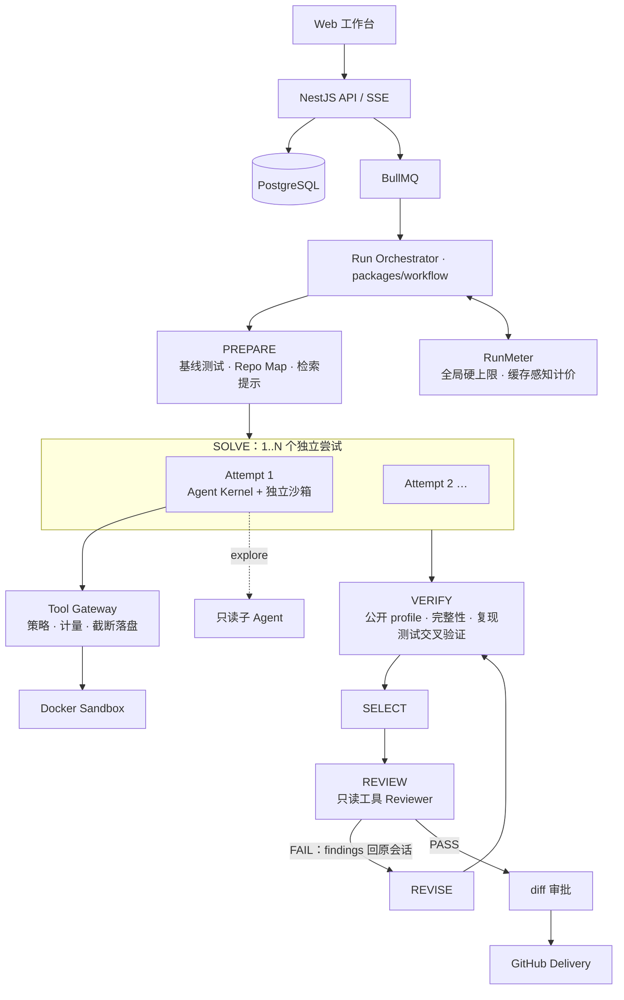

# DevFlow v4.0 重构方案：从“宿主逐步管控”到“自主决策 + 验证驱动”

> **基线：** 分支 `codex/docs-consolidation-20261014` @ `06ef552`（运行行为同 `1f55499`），包版本 2.4.0。
> **依据：** 当前源码；[溯源书](docs/devflow-history-and-architecture.md)；`docs/performance/results/` 中 2026-10-13 十题批次（`0bf544c`）与失败五题定向复测的原始请求和回执。
> **性质：** 本文只是方案，不含实现。文中“门槛”是阶段决策条件，必须用冻结批次验证，不是成绩预测。

---

## 0. 结论先行

1. **6/10 的瓶颈不在模型能力，也不在 Agent 角色数量，而在宿主把模型捆住了。** 最新五个失败题中，至少 E10、E08、E06 三题有直接证据：模型已经知道下一步该做什么，或者只差一次普通的 grep 或测试运行，却被写入范围锁、检索原语、预算预留或 Schema 规则挡住。
2. **控制面和能力面严重失衡。** 预算、上下文、重规划、团队和执行器等控制代码超过 2.5 万行，Agent 实际能用的工具层只有约 1,150 行；`DefaultAgentRuntime.run()` 一个方法就约 2,100 行。10/06 以来的 91 个提交中有 36 个是 fix，集中在预算、团队协议、上下文和恢复上。每修一个症状就多一层控制，复杂度越滚越大。
3. **推荐方向：把信任边界从“每一步”外移到“沙箱边界 + 交付关口”。** 在沙箱里，让一个强 Agent 用通用工具（shell、grep、读写、跑测试）自己循环；宿主负责隔离、计量、独立复验、候选选择和交付审批。规模化靠**并行独立尝试 + 测试驱动选择**，不靠 Coordinator 和 Investigator 之间的消息协作。
4. **保留真正有价值的工程资产：** Docker 沙箱和路径安全、固定基线和 SHA 身份、公开验证 profile 和多语言诊断解析、Lease/CAS 持久化、事件和 SSE、交付审批和 GitHub 幂等、严格评测。workflow/team 路径先冻结作对照，不立即删除。
5. **先用三个低成本实验验证诊断，再投入重写**（§5 Phase 0）。最关键的一个：用同一个模型跑一个约 150 行、只有 bash 工具的对照 Agent。如果它在 E01–E10 上不输现有系统，重写方向就直接得到证实。

---

## 1. 诊断：6/10 是怎么来的

### 1.1 逐题失败归因

数据来自十题批次 `0bf544c` 和截至 `1f55499` 的定向复测。

| 案例                            | 直接失败原因                                                                                                                                  | 关键证据                                                                                                                                          | 根因        |
| ------------------------------- | --------------------------------------------------------------------------------------------------------------------------------------------- | ------------------------------------------------------------------------------------------------------------------------------------------------- | ----------- |
| E01 MiniIndex（C++，11.8 万行） | 十题批次：公开测试未通过，但独立评分通过。复测：补丁已全部验收通过，但在 Review 前被费用预检拦下。                                            | Coding 在提交前无法自己运行公开测试；Review 预约在补丁完成后才竞争剩余费用。                                                                      | R2 R4       |
| E06 LogStream（C++）            | 始终没有形成 Plan。三个 Investigator 都以 STALLED/BUDGET_STOP 结束，最后报 “Resource Budget Scheduler denied the operation before dispatch”。 | 12 次请求、11.2 万输入 Token 全部花在调查上，Coding 一次也没派发。                                                                                | R3 R4 R6    |
| E07 FormStudio                  | 十题批次：“Collaboration ended: MODEL_OUTPUT_INVALID”。定向复测 PASS。                                                                        | 一次决策 Schema 不合规就终止整个协作。                                                                                                            | R7          |
| E08 PyPlugin（Python）          | 三个 Investigator 都没找到 `run` 命令的查找代码，结果为 INSUFFICIENT_EVIDENCE。复测时 Repair 差 10,439 Token，没有派发。                      | Investigator 把 `PluginNotFoundError(`、`plugin_group.command("r` 当查询词，交给了自然语言检索。19 次团队请求消耗 12.9 万输入 Token，占全程 70%。 | R3 R4 R6    |
| E10 FlowEngine（TS）            | 四个注入文件找到三个。第四个（event codec）在测试反馈后已被模型准确诊断，但写入范围被锁定，而 Replan 报价需要 43 次逻辑工具，只剩 22 次。     | 见 §1.2                                                                                                                                           | R1 R2 R4 R5 |

### 1.2 E10 解剖：模型知道答案，但只剩 `finishPhase` 可用

数据来自 `docs/performance/results/new-dataset-failed-five-e10-r1-20261013/requests/`。

1. **团队调查**：2 次 Coordinator 请求加 7 次 Investigator 请求，共 64,022 输入 Token。正确找到 `status-codec.ts`、`run-serializer.ts`、`run-summary-builder.ts`，漏掉了 `event-codec.ts`。
2. **Plan 审批**：把这三个文件批准为 EDIT 范围。
3. **Coding**：7 次请求，共 121,208 输入 Token，改了三个文件。其中一次 `replaceText` 返回 `TEXT_MATCH_COUNT`，需要重试。随后 finishPhase，宿主验证结果为 build/typecheck/lint PASS，test FAIL，还剩 18 个失败。
4. **模型的判断完全正确**：剩余失败都在事件发射和 codec 上（`emitted-events.test.ts:105` 收到的是 NODE_COMPLETED），不在批准的三文件范围内。于是它提交 `SCOPE_CONFLICT`，并附上三个测试文件作为证据。
5. 这次 finishPhase 先被拒绝过一次，理由是“at most four combined source references”。
6. 真正扩大范围需要 43 次逻辑工具，而只剩 22 次，所以 Planner 没有派发，整题 FAIL。
7. **最后一次请求**有 40 条消息，其中包括 HOST_CURRENT_SCOPE_RESERVE、HOST_TIME_RESERVE、HOST_CONVERGENCE、Convergence warning、POST_PATCH_COMPLETION、HOST_CONTEXT_REFERENCES 等控制消息，以及 7 条 `"stale":true` 的旧工具结果占位。**此时开放的工具只有 `finishPhase`。**
8. 实际缺的修复只是删掉 `event-codec.ts` 里注入的 7 行。

**反事实：** 一个常规的编码 Agent 循环会先跑测试，看到 33 个公开失败，其中有 “EventCodec round trip…”；然后 `rg NODE_SKIPPED src/` 定位到 `encodeEvent`，删掉注入块。大约 3 次工具调用就能完成。

### 1.3 七个结构性根因

**R1 写入权限在理解问题之前就被锁定。** PLAN Approval 把“候选文件”变成了写入白名单（见 `plan-proposal.ts`、`scope-replanning.ts`）。但真实修复涉及哪些文件，往往要等跑过测试才会完整暴露。要扩大范围，就得走 Replan、新审批、新沙箱恢复，单次报价就超过剩余额度。沙箱是一次性的，往沙箱里写东西本身没有风险，风险在交付环节。

**R2 Coding Agent 自己看不到测试结果。** `runDiagnostic` 默认不注册；即使开启，也限制为每个 Run 最多两次、每次 30 秒（[approval-workflow-run-executor.ts:7449](apps/worker/src/runs/approval-workflow-run-executor.ts:7449)）。E10 的模型在 finishPhase 中直接写了 “no runDiagnostic tool was available”。所以每验证一次，都要经过 finishPhase、宿主 Final Validation、反馈、恢复会话这一整轮，并且每轮都要重新报价和预留。主流编码 Agent 的核心回路是“改 → 跑 → 读失败 → 再改”，在 DevFlow 里却被拆成了跨阶段的昂贵往返。更可惜的是，公开测试在 broken 版本上本来就会失败（E10 有 33 个，用例名直接指向 EventCodec 和 skipped events），这些信息在第一次补丁之前从未交给模型。

**R3 检索原语弱，而且有限额。** 团队的 `SEARCH` 实际调用的是 `IssueLocalizer.retrieve`，也就是自然语言 RRF 召回（[team/workflow-bridge.ts:592](apps/worker/src/team/workflow-bridge.ts:592)），不支持精确字符串或正则搜索。Coding 虽然有基于 ripgrep 的 `searchCode`，但默认 `DEVFLOW_EXPLORATION_SEARCHES=2`、`DEVFLOW_EXPLORATION_READS=4`。而沙箱镜像里其实已经装了 ripgrep（[docker/sandbox/Dockerfile](docker/sandbox/Dockerfile)）。

**R4 最坏情况预留把预算变成了路障。** Scheduler 在派发前，要为下游所有可能的分支（纠正、Replan、Final Validation、Review 的 480 秒和 16K 高推理输出等）先做预留，上游工作因此被拒绝：E06 在派发前被拒，E08 的 Repair 差 10,439 Token，E10 的 Replan 差 21 次工具，E01 停在 Review 之前。预算被花在“证明自己不能做”上。

**R5 上下文太小，计费也不识别缓存。** Coding、Planner 和 Investigator 统一只有 32K 上下文，所以才需要约 4,400 行的投影、压缩和引用改写代码。而这些改写（`$contextRef`、`"stale":true` 占位、每轮插入的 HOST_* 提示）破坏了前缀稳定性，供应商的前缀缓存很难命中。最近八次运行中，输入 Token 占 95.9%。同时，`toTokenUsage`（[vercel-ai-model.ts:564](packages/agent/src/vercel-ai-model.ts:564)）丢掉了 AI SDK 已经提供的 `inputTokenDetails.cacheReadTokens`，所有重复前缀都按全价计入预算和费用。

**R6 多阶段、多 Agent 的交接把信息切碎了。** E08 中 19 次团队请求花掉 12.9 万输入 Token，只为找一个函数。Investigator 停滞后，Coordinator 新建的 Investigator 从零开始，日志里反复出现 “Starting investigation…”。真实批次中 AgentMessage 一直是 0。调查结论还要经过 Planner 摘要、Coding 重新读取，每交接一次都会丢信息、加成本。

**R7 Schema 一出错就终止，模型被控制文本淹没，而且几乎不思考。** 团队决策使用 `strictObject` 加长度上限，E07 在十题批次中因 MODEL_OUTPUT_INVALID 被直接终止；finishPhase 也有“最多四条引用”之类的规则。另一方面，解题角色全部是 `reasoning=low`：E08 的 14 次 Investigator 决策加起来只有 219 个推理 Token，平均每次输出约 88 Token。模型更像是在填表，而不是在分析。

### 1.4 体量对比：控制面是能力面的 20 倍以上

| 子系统（非测试代码）                                         | 行数      |
| ------------------------------------------------------------ | --------- |
| 生产执行器 `approval-workflow-run-executor.ts`               | 7,970     |
| Localization / PRG                                           | 7,834     |
| 上下文投影/压缩/WorkingSet/pre-patch/post-patch              | 4,383     |
| Agent Runtime（`runtime.ts`/`state.ts`/`coding-session.ts`） | 4,189     |
| Plan / Replan / Repair                                       | 3,886     |
| 预算/调度/预留                                               | 3,229     |
| 团队                                                         | 2,494     |
| Review                                                       | 1,716     |
| **工具层 `packages/tools`**                                  | **1,152** |

另外，测试代码约有 4.25 万行，大部分在验证控制逻辑。墙钟时间方面，E01 复测 r1 全程 631 秒，模型延迟只有 186 秒（29%）；r2 全程 701 秒，模型延迟只有 122 秒（17%）。

### 1.5 结论

v2–v3 把“可信”实现成了“宿主逐步核准模型的每个动作”。这样做的前提是宿主能事先预测解题路径：要改哪些文件、要读几次、要纠正几次。一旦预测错了（E10 的第四个文件、E08 的检索），模型就没有办法自己恢复。**加更多 Agent 解决不了这个问题，因为每个 Agent 都被关在同一个笼子里。**

---

## 2. v4 设计原则

| #   | 原则                        | 含义                                                                                                                                                            |
| --- | --------------------------- | --------------------------------------------------------------------------------------------------------------------------------------------------------------- |
| P1  | 信任边界外移                | 沙箱是一次性的。沙箱内只受资源和隔离约束；diff 离开沙箱前，必须经过宿主独立复验和人工审批。“模型声明不能代替验证”这条不变，只是验证放在产出上，不放在每一步上。 |
| P2  | 通用工具优先（ACI）         | 给 Agent 工程师用的工具：shell、grep、读、改、测。SHA、证据引用这类宿主语义改为内部记录，不再要求模型填写。                                                     |
| P3  | 验证驱动                    | 测试是 Agent 自己的仪器，鼓励先写复现；宿主在最后独立重跑全部检查。                                                                                             |
| P4  | 并行尝试扩展、子 Agent 隔离 | 用独立尝试加客观选择来扩展规模，用 `explore` 子 Agent 保护主上下文，不再搭角色流水线。                                                                          |
| P5  | 预算是天花板，不是路障      | 只设全局硬上限，每次调用前检查；不做多分支最坏情况预留；让 Agent 看得到自己的预算。                                                                             |
| P6  | 上下文追加式、缓存友好      | 前缀稳定、只追加；接近窗口上限时才压缩。                                                                                                                        |
| P7  | 简单优先、可删除            | 任何控制机制都要用消融数据证明价值，否则默认关闭。                                                                                                              |

---

## 3. 目标架构

### 3.1 全景



### 3.2 Agent Kernel（替代 2,100 行的 `run()`）

- **目标规模在 600 行以内。** 循环流程：构建请求（固定 system + tools + transcript）→ `meter.check()` → `model.generate()` → 解析工具调用 → Tool Gateway 执行（只读调用可并行）→ 追加结果 → checkpoint → 下一轮。遇到 `submit`、预算触顶或步数上限时结束。
- **Hooks：** `beforeModel`（预算提示、压缩）、`beforeTool`（策略）、`afterTool`（截断落盘、事件）、`onCheckpoint`。所有可选机制都以 hook 形式提供，不写死在循环里。
- **非法工具调用：** 把错误作为工具结果返回，让模型自己修正。不再有“唯一纠正信用”；只有连续 K 次（默认 3）非法调用才停止。
- **停滞检测：** 软性处理。例如同一失败指纹出现 3 次且 diff 没变，就注入一次提示；硬停止只由预算触发。
- **最后一轮：** 剩余预算只够一次调用时，只开放 `submit`（沿用现有思路，但不再叠加多层 HOST_* 消息）。
- **Agent 内部没有阶段状态机。** 计划由 Agent 用 `todo` 工具自己维护，UI 上可见。

### 3.3 工具集（ACI）

| 工具                         | 作用                                                                                | 复用                                                                               | 默认限制                                                                               |
| ---------------------------- | ----------------------------------------------------------------------------------- | ---------------------------------------------------------------------------------- | -------------------------------------------------------------------------------------- |
| `bash`                       | 在沙箱内执行命令：rg、find、`sed -n`、运行测试或脚本、`git diff`                    | `DockerSandboxManager` exec                                                        | 单次 120 秒（可配置，最多 600 秒）；输出保留头尾 16KB，全文落盘可再读；无网络；非 root |
| `read_file`                  | 按行号读取                                                                          | builtins `readFile`                                                                | 单次最多 2,000 行或 64KB                                                               |
| `grep` / `glob`              | ripgrep 正则搜索和文件匹配                                                          | `searchCode`                                                                       | 截断结果并返回总数                                                                     |
| `edit_file`                  | str_replace：要求唯一匹配，成功时返回编辑后的片段和行号；失败时给出最接近的候选片段 | [replace-text.ts](packages/tools/src/replace-text.ts)                              | 拒绝保护路径                                                                           |
| `write_file` / `apply_patch` | 新建文件或应用多 hunk 补丁                                                          | builtins                                                                           | 拒绝保护路径                                                                           |
| `run_tests`                  | 运行宿主已知的公开 profile（可指定文件或用例），返回解析后的失败摘要和稳定指纹      | [public-verification.ts](apps/worker/src/runs/public-verification.ts) + 诊断解析器 | 单次最多 300 秒                                                                        |
| `code_nav`                   | 查询定义、引用和调用者                                                              | `relation-graph.ts`、`prg-parser.ts`                                               | 结果有上限                                                                             |
| `explore`                    | 派生只读子 Agent，返回不超过 2K Token 的报告（带 file:line）                        | Agent Kernel                                                                       | 用便宜模型，最多 15 步，计入同一个 RunMeter                                            |
| `todo`                       | Agent 自己维护的计划清单                                                            | 新增                                                                               | —                                                                                      |
| `submit`                     | 结束本次尝试并附摘要                                                                | `finishPhase` 大幅简化                                                             | 不限制引用数量                                                                         |

**为什么开放 `bash` 不会扩大攻击面：** 宿主现在本来就在同一个沙箱里执行仓库的 build/test 脚本来做 Final Validation，所以“不可信代码在无网络、无凭据的隔离容器里运行”早已存在，开放给 Agent 只是换了调用者。对保守部署，可以切换为命令白名单模式。

### 3.4 Run Orchestrator（替代 7,970 行执行器）

```
PREPARING → SOLVING → VERIFYING → SELECTING → REVIEWING
   → (REVISING → VERIFYING …) → AWAITING_APPROVAL → DELIVERING → SUCCEEDED / FAILED / CANCELLED
```

- 每次状态转移都持久化，沿用现有 Run lease、`dispatchRevision` 和 CAS。
- 实现放在 `packages/workflow`，替换现在的 `NOT_IMPLEMENTED` 占位（[engine.ts](packages/workflow/src/engine.ts)），Worker 侧新增 `apps/worker/src/autonomous/`。目标总规模不超过 2,000 行。
- **恢复：** 每步追加 transcript；每次修改类工具执行后，在沙箱内用 `git stash create` 或隐藏 ref 打一个 diff 快照。恢复时从基线重建沙箱、应用最新快照、重放 transcript。回执未知的模型调用照常按“保留上界、不计零”处理（沿用现有好设计）。

### 3.5 PREPARE：确定性准备，不调用 LLM

1. 创建沙箱并固定 base commit（沿用现有实现）。
2. **基线测试：** 运行公开 profile，拿到 broken 版本上的失败用例和解析后的诊断（复用现有解析器）。如果真实 GitHub Issue 没有失败测试，记为 `NO_FAILING_TEST`，并在提示中要求 Agent 先写复现。
3. **Repo Map：** 用 PRG Atlas、tree-sitter 声明，加上与 Issue 的检索相关度排序，生成 4–8K Token 的仓库地图（文件树 + 关键符号签名）。
4. **检索提示：** 现有 RRF 召回的 Top-K 文件作为“可能相关”列表，只是提示，不是门槛。
5. 以上内容和 Issue 文本合成首条用户消息，保证缓存友好。

### 3.6 SOLVE

**单个尝试的行为模式**（写在提示里作引导，不强制）：理解 → 复现（写到 `.devflow/scratch/`）→ 定位（grep / code_nav / explore）→ 修复 → run_tests 并跑复现 → 迭代 → 自查 diff → submit。

**多尝试策略：**

- **默认自适应：** 先跑 1 个尝试。如果 VERIFY 失败，或 Review FAIL 后 REVISE 也没解决，再用剩余预算启动策略不同的尝试（换策略提示、温度或模型）。
- **高难度任务**（大仓、多语言、无失败测试）可以配置为一开始就并行 2–3 个尝试，缩短墙钟。
- **每个尝试有独立沙箱**（从基线快照复制），尝试之间不通信，所以不需要消息协议，也不会写冲突。
- **后续尝试会拿到前序尝试的失败摘要**（改过哪些文件、哪些测试还失败）作为提示。这是成本最低、最有效的“协作”。

### 3.7 VERIFY 与 SELECT

- 宿主对每个候选独立运行完整公开 profile（build → typecheck → lint → test），保留 NOT_RUN / NOT_CONFIGURED 语义。
- **完整性检查：** 保护路径、删除或修改既有测试、排除 scratch 文件、diff 规模异常。
- **复现测试交叉验证**（Agentless 思路）：收集各尝试写的复现脚本，要求它们在基线上失败、在候选上通过，再用它们给所有候选打分。
- **选择顺序：** 公开 profile 全部通过 > 复现测试通过数 > Reviewer 结论 > 归一化 diff 多数投票 > diff 更小。只有一个候选时跳过。

### 3.8 REVIEW 与 REVISE

- Reviewer 是一个独立的 Agent Kernel 实例，只给只读工具（read、grep、code_nav，以及在副本上 run_tests），优先选和求解模型不同家族的模型。它替换掉现在“宿主投喂片段 + 补证轮次 + 复现探针”这套约 1,700 行的机制。
- 输出沿用 PASS / FAIL / NEEDS_EVIDENCE 和 finding 生命周期，保留现有语义上的优点。
- **FAIL 时**，findings 作为用户消息追加到**被选中尝试的原 transcript** 里，在同一个会话中继续修改，不另开会话；最多 K 轮，默认 2 轮。
- **Review 预算是固定切片**（例如总额的 15%），在 SOLVE 开始时就划出，SOLVE 不能透支。这样就不会再出现 E01 那种“补丁正确，但没钱做 Review”的情况。

### 3.9 审批与自主级别

| 级别           | 人工关口                                         | 适用场景            |
| -------------- | ------------------------------------------------ | ------------------- |
| L0 Supervised  | 计划预览（可选，仅供参考）+ diff 审批 + 发布审批 | 首次接入的仓库      |
| **L1 Default** | diff 审批 + 发布审批                             | 默认                |
| L2 Autonomous  | 自动开 Draft PR，人在 PR 上审                    | 受信仓库、Benchmark |

即使在 L0，计划也只是建议，不是写入白名单；最终 diff 中计划外的文件会被标注出来。GitHub Push 和 PR 的独立审批及幂等机制保持不变。

### 3.10 RunMeter：替代 Scheduler 的多分支预留

- **硬上限：** 费用、墙钟、模型调用次数、总 Token。全部是全局上限，不按阶段划分。
- **每次模型调用前检查：** 预估成本 = 未缓存输入 × 单价 + 缓存输入 × 缓存单价 + max_output × 输出单价，必须不超过剩余可用额度（总额 − Review 切片 − 已用）。
- **缓存感知：** 价格表增加 `cachedInputPrice`；结算时读取 `usage.inputTokenDetails.cacheReadTokens`。
- **软感知：** 每 N 步在工具结果后附一行预算状态，不再单独插入控制消息。
- **保留：** 持久账本、CAS、回执未知时保留上界、恢复不重置期限。直接沿用 `resourceBudgetLedger` 格式的一个简化子集。
- **删除：** 操作计划报价树、PARALLEL/EXCLUSIVE 组合预留，以及按阶段划分的纠正、Replan 和刷新信用。

### 3.11 上下文与缓存

- 求解模型的上下文按模型实际窗口配置，建议至少 128K。如果当前供应商档位只有 32K，应优先更换求解模型。
- **Transcript 只追加：** system 和 tools 固定 → Issue 和 PREPARE 消息固定 → 交互历史往后追加。不回写旧消息，也就是不再插入 `"stale":true` 占位，不再做 `$contextRef` 改写。
- **工具输出在源头截断：** 保留头尾，全文落盘到 `.devflow/outputs/<id>.txt`，模型需要时自己去读。
- **编辑后由工具返回该区域的最新片段**（带行号），取代“旧源码已失效”这类提示。
- **接近窗口 80% 时压缩一次：** 保留 system/Issue/PREPARE 前缀和最近 K 轮，中间历史交给便宜模型摘要。摘要必须保留已改文件、当前测试状态、已排除的假设和待办。
- **指标：** 缓存命中率 = cacheRead / input，目标在 60% 以上。这个数要按供应商实测：需要先确认当前供应商和模型是否支持隐式前缀缓存，以及折扣是多少。即使不支持，追加式 transcript 也能省掉改写开销，换供应商时还能立即受益。

### 3.12 多 Agent 的重新定位

| v3 机制                     | v4 处理                                                            | 理由                                                                                            |
| --------------------------- | ------------------------------------------------------------------ | ----------------------------------------------------------------------------------------------- |
| Coordinator 动态委派        | 主 Agent 按需通过 `explore` 工具派生子 Agent                       | 主 Agent 持有完整上下文，由它判断何时需要广度搜索；E08 证明独立的 Investigator 冷启动会重复劳动 |
| 多个 Investigator 并行      | 并行独立尝试（完整求解，不是局部调查）                             | 完整候选可以用测试客观比较；局部调查结论还需要再整合                                            |
| AgentMessage / CHALLENGE    | 不再需要；失败摘要在尝试之间单向传递；Reviewer findings 回到原会话 | 真实批次中消息数始终为 0                                                                        |
| Task Board / SharedEvidence | 降级为可观测性：UI 展示尝试树和子 Agent 报告                       | —                                                                                               |
| 唯一 Coding 写者            | 每个尝试有独立沙箱，天然只有一个写者                               | 不再需要用租约协调写入                                                                          |

`executionMode=team` 的代码冻结保留，作为对照组。

### 3.13 安全与完整性：哪些不变，哪些移动

**不变：**

- Docker 隔离：无网络、非 root、CPU/内存/PID 限制。
- 凭据不进沙箱。
- 路径限定，拒绝 symlink 逃逸。
- 保护路径（CI 配置、锁文件、密钥、Benchmark 模式下的受保护测试）在编辑工具和 VERIFY 两处检查。
- 仓库内容、Issue 和工具输出一律视为不可信数据。
- Tool Gateway 在执行侧做校验。
- GitHub 写入需要独立审批，并保持幂等。
- Run lease 和 CAS。
- 严格评测与平台 SUCCEEDED 分开统计。

**移动：**

- 写入授权：从“PLAN Approval 文件白名单”移到“diff 审批”。
- 证据身份（SHA、行范围）：从“模型必须填写”改为“宿主内部记录”。事件和 Artifact 仍完整审计每一次读写。
- Review：从“宿主投喂”改为“Reviewer 自己取证”。

**提示注入：** 在没有网络和凭据的沙箱里，注入最坏的结果是产出一个糟糕的 diff。它会被 VERIFY、Reviewer 和人工 diff 审批三层拦截。

---

## 4. 模块去留矩阵

| 模块                                                                                                      | 处理                | 说明                                                      |
| --------------------------------------------------------------------------------------------------------- | ------------------- | --------------------------------------------------------- |
| `packages/sandbox`（Docker 管理、路径安全、本地快照）                                                     | **保留**            | 增加 bash 执行的截断落盘和快照复制                        |
| `packages/database`（Run/Task/Event/Artifact/Approval、lease/CAS）                                        | **保留**            | 新增 transcript、attempt 两类 Artifact，Schema 尽量不变   |
| `apps/api`、`apps/web`                                                                                    | **保留并适配**      | Run 详情页改为展示 transcript、工具调用、测试运行和尝试树 |
| `packages/github`（交付、幂等）                                                                           | **保留**            | —                                                         |
| `public-verification.ts` + 诊断解析                                                                       | **保留并复用**      | 同时用于 `run_tests` 工具、PREPARE 基线和 VERIFY          |
| `replace-text.ts`                                                                                         | **保留并放宽**      | 作为 `edit_file` 内核，补充“最接近候选”提示               |
| Localization 中的 `retrieval`、`query-index`、`relation-graph`、`prg-parser`、`repository-atlas`          | **改为工具和提示**  | 改作 Repo Map、`code_nav` 和检索提示，不再是强制阶段      |
| `benchmark-evaluation`、`packages/eval`、实验控制器                                                       | **保留**            | 增加并行、多次运行和失败自动分类                          |
| `vercel-ai-model.ts`                                                                                      | **小改**            | 记录 `cacheReadTokens`，保留 `prepareRequest`             |
| 预算相关：`resource-budget-scheduler`、`workflow-budget`、`coding-budget`、`repair-reserve`、`task-quote` | **重写为 RunMeter** | 约 300 行，兼容读取旧账本                                 |
| `context-projection`、`context-compression`                                                               | **重写**            | 改为追加式 transcript 加压缩，约 400 行                   |
| `review-*`（约 1.7K 行）                                                                                  | **重写**            | 改为带只读工具的 Reviewer Agent，保留输出语义             |
| `packages/workflow`                                                                                       | **实现**            | 承载 Orchestrator 状态机                                  |
| `approval-workflow-run-executor.ts`、`plan-*`、`scope-replanning`、`replan-*`、`repair-*`                 | **冻结**            | 只服务 `workflow` 模式；Phase 4 达到门槛后删除            |
| `team/*`、`packages/shared/src/team.ts`                                                                   | **冻结**            | 只服务 `team` 模式；Phase 4 达到门槛后删除                |
| `DefaultAgentRuntime`、`pre-patch`、`post-patch`、`working-set`、`execution-packet`                       | **冻结**            | 同上                                                      |

---

## 5. 实施路线

**总体原则：**

- 新增 `executionMode: "autonomous"`，与旧路径共用同一套 API、DB 和 Web。
- 每个阶段以一次冻结评测批次作为门槛；没达标就先分析，不扩大范围。
- 每新增一项控制机制，都要附消融数据。
- 下面的工作量按“一名开发者加 AI 编码 Agent”估算，只是粗略量级。

### Phase 0：先验证诊断，再搭评测底座（约 3–5 天）

| 任务           | 内容                                                                                                                                                                                                                              |
| -------------- | --------------------------------------------------------------------------------------------------------------------------------------------------------------------------------------------------------------------------------- |
| 0.1 缓存计量   | `toTokenUsage` 记录 `cacheReadTokens`，价格表支持缓存单价；回算最近两批真实运行中可缓存的输入比例。改动很小，而且之后每个阶段都会用到。                                                                                           |
| 0.2 对照 Agent | 在同一 Docker 镜像中，用同一模型（当前为 GLM-5.3）跑只有 bash 工具的最小 Agent。可以直接用 SWE-agent 团队开源的 mini-swe-agent，也可以用 TS 按同样思路写约 150 行。E01–E10 每题跑 3 次，每题 ¥4。                                 |
| 0.3 现系统消融 | 在 E06、E08、E10 上各跑 2 次，三档逐级叠加：(a) 开启 `runDiagnostic` 且不限次数，同时取消探索限额；(b) 在 (a) 的基础上把 Coding 写入范围放开到全仓（保留保护路径）；(c) 在 (b) 的基础上把上下文提到 128K，reasoning 提到 medium。 |
| 0.4 评测框架   | 并行运行；记录轨迹；自动给失败分类（定位失败、修复不完整、预算、协议、环境）；每题跑 3 次，报告均值和区间。                                                                                                                       |
| 0.5 外部留出集 | 选 30–50 个真实 Issue（SWE-bench Verified 子集；多语言可以从 Multi-SWE-bench 里选 TS/Java/C++），用来防止对 E01–E10 过拟合。                                                                                                      |

**决策点：**

- 如果 0.2 的对照 Agent 不低于现系统（5–6/10），或者 0.3 的 (a)/(b) 让 E10、E08 明显改善，就进入 Phase 1。
- 如果三项都没有改善，说明主要瓶颈在模型能力。这时应先换求解模型再谈架构，这本身也是一个重要结论。

### Phase 1：Agent Kernel + ACI + autonomous 单尝试（约 1.5–2 周）

**涉及文件：**

- 新增 `packages/agent/src/kernel/`：`loop.ts`、`hooks.ts`、`transcript.ts`、`compaction.ts`。
- 新增 `packages/tools/src/aci/`：`bash.ts`、`grep.ts`、`edit.ts`（包装 replace-text）、`run-tests.ts`（包装 public-verification）、`todo.ts`、`submit.ts`。
- 新增 `apps/worker/src/autonomous/`：`orchestrator.ts`、`prepare.ts`、`attempt.ts`、`meter.ts`。
- `packages/workflow/src/engine.ts`：实现状态机。
- `packages/shared`：`ExecutionModeSchema` 增加 `autonomous`。
- Web：Run 详情页展示 transcript、工具调用和测试运行（复用事件流）。

**门槛：**

- E01–E10 的 pass@1（每题 3 次）均值至少 7/10，并且不低于 legacy。
- 平均费用不超过 ¥4。
- `test:p3` 沙箱安全测试全部通过。
- 在尝试中途杀掉 Worker 后，能从 checkpoint 恢复，且不会重复产生副作用。

### Phase 2：Verify / Select / Review / Revise（约 2 周）

**内容：**

- 自适应多尝试。
- 复现测试交叉验证。
- 选择器。
- 带只读工具的 Reviewer 和 REVISE 回路。
- Review 预算切片。
- diff 审批关口，并接通 GitHub 交付。

**门槛：**

- E01–E10 在自适应 best-of-N 下至少 9/10。
- 在外部留出集上，相对 Phase 1 的 pass@1 有可量化提升。
- 记录 Review 误批率和误拒率。

### Phase 3：成本、上下文与大仓（约 1–1.5 周）

**内容：**

- 压缩。
- `explore` 子 Agent。
- Repo Map。
- 保持前缀缓存的约束。
- 预算提示。
- 模型路由：`explore` 和压缩用便宜模型。

**门槛：**

- 解决率不下降的前提下，每解决一题的成本比 Phase 2 降低 40%。
- 缓存命中率达到 §3.11 的目标。
- 大仓案例（E01 11.8 万行、E08 4.3 万行）没有回退。

### Phase 4：产品化与旧路径退役（约 2 周）

**内容：**

- API 和 Web 支持自主级别。
- GitHub Issue 接入：通过 webhook 或 label 触发 Run，产出 Draft PR。
- 补充文档。
- 默认 `executionMode` 切换为 `autonomous`。

**退役条件：** autonomous 在两套评测集上连续两次冻结批次都不低于 legacy 后，在一个可追溯的提交里删除 workflow/team 旧路径（约 2.5 万行），并保留一个 tag 供考古。

**发布：** 4.0.0。

---

## 6. 评测体系

- **套件：**
  - E01–E10：回归和冒烟，每题 3 次。
  - 外部留出集：真实 Issue。
  - 真实开源仓库试点：需事先获得授权，只产出 Draft PR。
- **主指标：** 严格解决率（pass@1 和自适应 best-of-N）、每解决一题的成本、墙钟中位数和 P90。
- **诊断指标：**
  - 文件级定位召回：候选 diff 覆盖 golden 文件的比例。
  - 首次补丁耗时和测试运行次数。
  - 缓存命中率。
  - Review 误批率和误拒率。
  - 各失败类别占比。
- **统计口径：**
  - 10 题样本中 1 题就是 10 个百分点，所以单次批次相差 1 题属于噪声。
  - 每题至少跑 3 次并报告区间。
  - 只在同模型、同预算、同镜像、同评分标准下比较。
- **消融矩阵**（Phase 2 之后做）：
  - 有无 `run_tests`、有无 `bash`。
  - N=1 与 N=3。
  - Reviewer 有无工具。
  - 128K 与 32K 上下文。
  - reasoning low 与 medium。
  - `explore` 开与关。

---

## 7. 风险与对策

| 风险                               | 对策                                                                                                                   |
| ---------------------------------- | ---------------------------------------------------------------------------------------------------------------------- |
| 开放 bash 带来的安全问题           | 仓库脚本本来就在同一个沙箱里执行；沙箱无网络、无凭据、非 root，并有资源限制；可以切换为白名单模式；diff 审批前不出沙箱 |
| 放开写入范围导致补丁膨胀或篡改测试 | VERIFY 做完整性检查；保护测试路径；Reviewer 审查改动范围；选择器偏好小 diff；最后还有人工 diff 审批                    |
| 多尝试推高成本                     | 自适应 N，先跑单尝试；利用缓存；子 Agent 用便宜模型；RunMeter 设硬上限                                                 |
| 对 E01–E10 过拟合                  | 使用外部留出集；不针对单题加规则                                                                                       |
| 重写期间失去现有能力               | 新旧路径并存；旧路径冻结、可随时回退；每阶段都有冻结批次                                                               |
| 模型本身能力不足                   | Phase 0 设决策点；模型可插拔，换模型不需要改架构                                                                       |
| 审计和可追溯性下降                 | 事件流记录每次工具调用和读写的文件，SHA 由宿主记录，transcript 完整保存                                                |
| 供应商不支持前缀缓存               | 追加式 transcript 仍能降低开销；价格表按实际填写；必要时更换供应商                                                     |

---

## 8. 附录：证据索引

| 主张                                          | 位置                                                                                                                        |
| --------------------------------------------- | --------------------------------------------------------------------------------------------------------------------------- |
| `runDiagnostic` 限制为每 Run 两次、30 秒      | [approval-workflow-run-executor.ts:7449](apps/worker/src/runs/approval-workflow-run-executor.ts:7449)                       |
| Coding 系统提示词                             | [workflow-stage-policy.ts:97](apps/worker/src/runs/workflow-stage-policy.ts:97)                                             |
| `run()` 约 2,100 行                           | [runtime.ts:210](packages/agent/src/runtime.ts:210) 至 `:2319`                                                              |
| 丢弃 `cacheReadTokens`                        | [vercel-ai-model.ts:564](packages/agent/src/vercel-ai-model.ts:564)                                                         |
| 团队 SEARCH 走自然语言召回                    | [workflow-bridge.ts:592](apps/worker/src/team/workflow-bridge.ts:592)                                                       |
| 团队决策 strict Schema                        | [team.ts:24](packages/shared/src/team.ts:24)                                                                                |
| 32K 上下文、探索 4 读/2 搜                    | [.env.example](.env.example)：`LLM_*_CONTEXT_TOKENS=32000`、`DEVFLOW_EXPLORATION_READS=4`、`DEVFLOW_EXPLORATION_SEARCHES=2` |
| 沙箱镜像已装 ripgrep                          | [docker/sandbox/Dockerfile](docker/sandbox/Dockerfile)                                                                      |
| WorkflowEngine 仍是占位                       | [engine.ts](packages/workflow/src/engine.ts)                                                                                |
| E10 轨迹（17 次请求，最后只开放 finishPhase） | `docs/performance/results/new-dataset-failed-five-e10-r1-20261013/requests/`                                                |
| E08 轨迹（三个 Investigator 停滞）            | `docs/performance/results/new-dataset-failed-five-e08-r1-20261013/requests/`                                                |
| E06 轨迹（未进入 Planner）                    | `docs/performance/results/new-dataset-failed-five-e06-r2-20261013/requests/`                                                |
| 十题批次失败原因                              | `docs/performance/results/new-dataset-quality-rerun-e*-20261013/cases/`                                                     |
| E10 注入内容（4 个文件，+27/−3）              | [datasets/E10-FlowEngine/benchmark/injection.patch](datasets/E10-FlowEngine/benchmark/injection.patch)                      |
