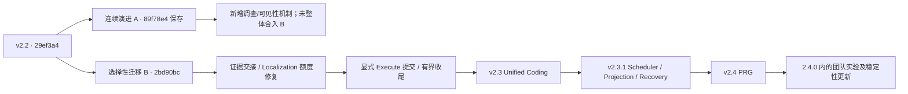
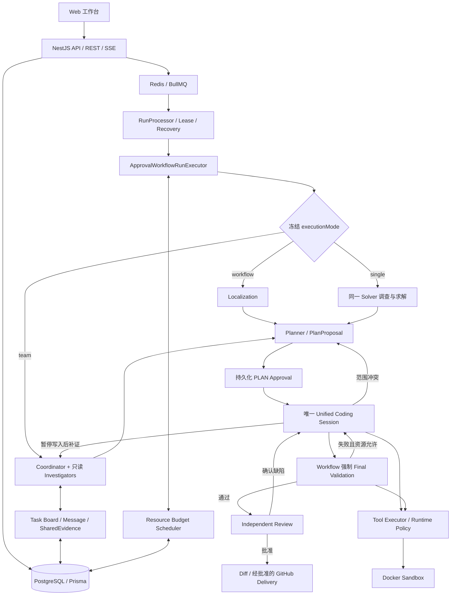

# DevFlow 历史版本变更溯源书：架构、实现与当前问题

核查日期：2026-10-14，北京时间。源码基线：`d7ce011`；最近运行行为提交：`1f55499`；当前包版本：**2.4.0**。本文整合历史设计、验收和复习文档，再以当前源码校正过时描述。文档整理本身不改变运行实现，也没有新增真实实验。

## 1. 阅读方法与项目定位

DevFlow 将仓库任务或 GitHub Issue 转化为可审批、可恢复、可审计的代码修复过程。模型提出假设、选择调查方向、规划和编辑；DevFlow 管理源码身份、工具授权、预算、确定性验证、持久化与交付。这里的“宿主”指 Worker、Runtime、工具策略和数据库控制代码；Docker 是宿主使用的隔离执行环境。

本文分三部分：第 2—3 节说明版本演进；第 4—10 节解释当前架构和重点模块；第 11—13 节汇总真实验证、未解决问题及文档整理。复习时先理解一次 Run 怎样流转，再看证据、预算和恢复怎样约束各阶段。

必须区分四件事：模型输出合法、宿主允许执行、补丁行为正确、完整工作流成功。合法 Plan、存在 diff、公开测试通过或 Reviewer 批准，任何单项都不足以证明 Issue 已修复。

### 版本称呼与代码身份

早期提交标题使用 v1.0/v1.1/v1.2，但根 `package.json` 仍为 `0.1.0`；`fd24ae8` 标题称 v2.1，包版本仍为 `2.0.0`。本文保留历史称呼，明确列出实际包版本，不补造发布。

当前已经实现 v3 团队实验代码，但没有升到 3.0.0。`executionMode` 默认仍为 `workflow`，团队需要显式启用。当前本地 `main` 与已缓存的 `origin/main` 指向 `57f025b`（2.3.1）；本次审计源码位于后续开发分支。此处描述本地 Git 引用，不宣称已核实 GitHub 的实时发布状态。

## 2. 版本总表

| 历史称呼 / 阶段             | 日期与代表提交                                 | 实际包版本     | 主要变化与证据边界                                                                                                                         |
| --------------------------- | ---------------------------------------------- | -------------- | ------------------------------------------------------------------------------------------------------------------------------------------ |
| 初始化                      | 2026-09-19，`9f9dc39`                          | 0.1.0          | 建立 monorepo、Agent/Tool/Sandbox 端口、API/Worker、审批与 Web/SSE 基础。                                                                  |
| v1.0                        | 2026-09-21，`18b00fe`                          | 0.1.0          | 补齐固定基准、LOCAL 快照、GitHub 交付与 Benchmark 等平台链路，并整理阶段上下文与效率机制。                                                 |
| v1.1                        | 2026-09-21，`15c1bd0`                          | 0.1.0          | 文档归档、许可证、中文入口和工程说明整理；不作为一次新的修复能力提升。                                                                     |
| v1.2                        | 2026-09-21，`ef222be`                          | 0.1.0          | README、项目脚本和前端生成配置的小调整。                                                                                                   |
| 定位 / Phase 1.5—1.7.2 实验 | 2026-09-28—10-03；后续并入 v2.0                | 当时开发工作区 | 索引、EvidencePack、WorkingSet、修改观察、收尾和补丁前执行实验；阶段编号不是独立语义版本。正式九题曾无可信首补丁，不能把请求缩小当作通关。 |
| v2.0                        | 2026-10-06，`b6a3be5`                          | 2.0.0          | 精简 Planner、阶段模型、精确编辑、共享静态图和当前源码证据；开始取得真实 GitHub Issue 严格成功。                                           |
| v2.1                        | 2026-10-06，`fd24ae8`                          | 2.0.0          | 强化 Review 补证/复现、任务范围裁决、Repair 答复和 Review 输出恢复。提交称呼未同步包版本。                                                 |
| v2.2                        | 2026-10-07，`29ef3a4`                          | 2.2.0          | 多语言诊断、完整公开验证 profile、编辑/证据一致性、有界范围重新规划与候选恢复。新多语言数据集暴露跨层定位和资源衔接问题。                  |
| v2.2 选择性迁移             | 2026-10-08，`2bd90bc` 至 `58a1c5c`             | 2.2.0          | 从 v2.2 基线谨慎迁移预算、证据和定位改进；未整体合入旧调查状态机。初版导航撤回，后续补齐；E07/E10 当时仍未严格通过。                       |
| v2.3                        | 2026-10-08，`109b679`                          | 2.3.0          | Execute/Repair 合并为一个持久化 Coding Session；公开测试和 Review 失败返回同一会话。E07 严格通过，达到当时升版条件。                       |
| v2.3.1                      | 2026-10-10，`e9f2a88`，标签 `v2.3.1`           | 2.3.1          | 整合 Resource Budget Scheduler、确定性 Context Projection、动态工具契约、审批恢复与参数纠正。                                              |
| v2.4                        | 2026-10-12，`93342f5`                          | 2.4.0          | 接入 PRG：Atlas、渐进扩图、动态调查、四类语言解析和版本化交接。冻结 PRG 三题严格 1/3（E05），符合该轮门槛；没有证明一般性定位收益。        |
| v3 团队实验                 | 2026-10-13，`6a44971`、`79ebac1`、`3ee3a54` 等 | 2.4.0          | 独立调查 Agent、任务板、消息、共享证据、原子回执与租约防护；保留唯一 Coding 写者。真实通信门槛未满足，未发布 3.0.0。                       |
| 稳定性与本轮修复            | 2026-10-13—14，至 `1f55499`                    | 2.4.0          | 工作记忆、受控摘要、分阶段计价、编辑/协议纠正、精确证据引用、实际可见性审计与当前范围预算分支；最新五题定向验证只有 E07 严格通过。         |

### 2.1 v1：先形成可信平台骨架

早期实现首先解决“模型在哪里执行、谁保存状态、谁批准代码和发布”。API 与 Worker 分离；工具通过 Docker 操作源码；Repository、Task、Run、Approval、Event、Artifact 构成持久化对象；SSE 将事件展示给用户。GitHub 写入具有独立审批和幂等标记，评测也与 Agent 的自述分开。

v1.1/v1.2 主要是工程与文档整理。之后的 Phase 1.5/1.6/1.7 实验增加路径/符号/词法检索、不可变索引、WorkingSet、修改后 diff 核实、缓存失效和生命周期观测。Phase 1.7.2 尝试缩小补丁前输入，但正式九题 First Patch 为 0/9。小输入、更早停止和计算器夹具成功，都不能代替真实 Issue 验收。

### 2.2 v2.0：把“规划正确格式”与“修复正确行为”分开

旧 Plan 协议要求行为审计、精确符号和大量短字段，导致模型在真正编辑前被卡住。新 `PlanProposal` 只表达方向、候选文件、验证和未决问题。宿主承担保护文件与路径检查，审批确定写入范围，Coding 再核实当前实现。

同时加入阶段模型配置、`replaceText`、完整文件 SHA、静态证据交接和共享关系查询。修复了 Localization 配置 4,096 输出却被内部压成 1,536、推理耗尽后最终 JSON 为空等工程问题。九题最终单批严格 5/9；一题仅因费用中断而单独续测成功，历史覆盖有六题成功，但不能把续测拼成同一冻结批次的 6/9。

### 2.3 v2.1：Review 的来源、行为与任务范围分别校验

Review 维持无直接工具调用，宿主补齐当前/基准源码并执行受控公开复现。finding 区分真实缺陷、证据缺口和建议，再区分 Issue 未解决、补丁回归、无关既有缺陷及关系未明。无关既有缺陷可以 `DEFERRED`，不驱动本次修改；旧问题不能因模型遗漏而自动关闭。

Repair 保留诊断和未完成 finding，可逐项修复或提出反证。Review 使用更强模型、high 思考；`LENGTH` 丢弃不完整判断，允许 compact/low 恢复。补证、复现和恢复都有持久化额度。后续九题严格 6/9；定向三题 2/3，另有一题公开 Test/Review 都通过而独立 Issue 失败，说明 Review 仍可能误批。

### 2.4 v2.2：面对更大的多语言仓库

新数据集从 TS/JS 扩展到 Python、Java、C++，暴露了只测行为、不跑构建/类型检查，编译错误未准确交接，LF/CRLF 编辑失败，日志噪声被当作进展，以及已找到范围外目标却无法重新规划的问题。

本版本引入按 build → typecheck → lint → test 执行的公开 profile、共享诊断解析、稳定失败指纹、当前源码引用和一次有界 Replan。新审批前保存实际累计变更；批准后核实基准、SHA、新建/删除身份，恢复候选。它改善了工程闭环，但辅助层修复未覆盖消费者、后续预算不足和错误完成判断持续暴露。

### 2.5 v2.3：统一 Coding，而非重复启动 Repair

`ba823de`、`93ba997` 将初次编辑、测试失败修订和 Review 缺陷处理合并为一个 Session。失败反馈更新同一状态和历史；工具、检查点、预算与纠正信用连续，测试由 Workflow 执行。`FIX`/`REPAIR` 仍出现在数据库和指标中，表示失败处理阶段，不代表另一个独立 Agent。

最终冻结实现 `73ec92f` 的 E07 严格通过，满足当时“E07 或 E10 任一成功”的 v2.3 门槛。有效目标批次 E07/E10 为 1/2，纠正配置后的回归 E02/E08 为 1/2。不能据此说 E10 或全部 P0 已关闭。

### 2.6 v2.3.1：资源、请求和工具契约走向一致

Scheduler 将零散预留变成操作计划报价、持久化预约、派发准入和实际结算。E10 已真实完成一次 Replan、新审批和 Session 恢复，但仍出现隐藏读取上限、时间/Token 预留及后续工具不足。

Context Projection 随后解决 E02 恢复后请求 98,090 字节超过 96,000 字节的问题：无损引用与确定性选择将原失败请求降到 75,114 字节，Scheduler 和 Provider 使用同一准备输入。真实复测又暴露 `queryRelations.paths` 字符串错误后没有纠正机会，因而增加统一字段诊断和有界参数恢复。E02 后续两次独立运行严格通过；四题定向批次仍只有 E08 通过。2.3.1 是这些验证改进的整合，不是四题全部通关。

### 2.7 v2.4 与 v3 实验：从渐进取证走向协作

PRG 复用原索引和关系图，增加结构 Atlas、区域排序、渐进补索引、正反向导航及可恢复调查。实际采用固定版本 TypeScript 与 `@vscode/tree-sitter-wasm@0.3.1`，不运行目标仓库插件来建图。动态模式由 Scheduler 控制调查机会，取消旧固定总调用门槛；单次读取和解析仍有安全上限。

v3 实验继续增加持久化团队，由 Coordinator 根据证据委派任务，Investigator 独立调查并交换引用。后续修复预算竞争、消息 ID、不可用接收者、租约、工作记忆和实际请求投影。代码具有通信能力，受控测试能证明反证改变另一 Agent 动作；然而最新真实批次 AgentMessage 仍为零。调查委派、共享资料和真正消息影响决策是三个不同验收层次，故包版本仍是 2.4.0。

## 3. v2.2 后的两条路线与回归溯源

路线 A 在 v2.2 上连续修改，最终以 `89f78e4` 保存；路线 B 回到 v2.2 选择性迁移，不整文件覆盖或整体合并。第一批预算/检查点迁移通过；第二批初版虽通过 66 项组件回归，却没有让 E07 的验证函数、E10 的实现与消费者共同可见，因此撤回。后来通过 `ffd1af3`、`1e206aa`、`7c0d0ff` 分别补齐交接、阶段额度和整体输出约束。

截至 10 月 8 日的历史复盘范围：八个冻结批次、25 次完整尝试、3 次严格通过；E07/E10 当时各七次均失败。A/B 的任务构成不同，不能比较 3/19 和 0/6 来裁决哪条路线能力更强。之后的 v2.3 E07 成功属于新的实现与批次。

| 现象                                                  | 历史归因                                              | 后续处理与当前边界                                                       |
| ----------------------------------------------------- | ----------------------------------------------------- | ------------------------------------------------------------------------ |
| 隐藏 Localization 额度、逐字段长说明被拒绝            | v2.2 继承的旧约束，更多调查将其暴露；不是迁移新增门槛 | 单独修复请求额度和整份输出预算；动态 PRG 后取消固定总次数。              |
| 测试、实现、消费者不能联合看到                        | 跨两条路线持续存在，补查重新构造视图还会丢失实现      | 累计证据、真实导入导航、完整行投影与实际展示审计；仍不保证完整行为定位。 |
| 调查 checkpoint 只因 revision 不同拒绝相同源码        | A 路线明确新增的交接回归                              | 没有迁入 B；使用不可变源身份与实际 SHA，而非单独依赖 revision。          |
| 首个合法补丁导致计划清空、强制结束                    | 基线已有收尾设计问题，非迁移新引入                    | `PATCH_STABLE` 与有效提交分开；预算边界仍可限制继续编辑。                |
| 未完成候选得到公开失败后跳过修复                      | B 路线后续明确暴露的控制回归                          | Unified Coding 保留未完成要求，失败反馈返回同一 Session。                |
| 工具 Schema 与隐藏执行上限不同、过期 finish-only 提示 | 审批恢复后的确定性 Runtime 缺陷                       | 动态契约共用、错误分类、控制提示失效、当前工具集合执行侧防护。           |
| 修复后出现 LENGTH、范围遗漏或新的预算停止             | 已确认的新失败表现，不一定由上次修改引入              | 冻结记录，区分证据/判断/输出/资源；没有提交间反证就不声称“新增回归”。    |

## 4. 当前系统全景

生产入口是 [Worker main](../apps/worker/src/main.ts) → [RunProcessor](../apps/worker/src/runs/run.processor.ts) → [ApprovalWorkflowRunExecutor](../apps/worker/src/runs/approval-workflow-run-executor.ts)。后者实际推进定位、规划、审批、Coding、验证、Review、Diff 和发布。

[packages/workflow 的 DefaultWorkflowEngine](../packages/workflow/src/engine.ts) 仍是 `NOT_IMPLEMENTED` 占位。该包的契约/状态转移仍被使用，但不能据占位引擎推断生产流程尚不存在。生产执行器很大，是当前技术债务之一。

Web 使用 Next.js 展示任务、审批、diff、事件和指标；API 使用 NestJS 接收并持久化请求。Redis/BullMQ 负责排队，PostgreSQL 才是状态真相。CLI 直接组合 Runtime/Tool/Sandbox，适合开发验证，不等价于具有完整审批、独立 Review 和严格评测的生产 Worker 路径。

### 六个基本对象与四种身份

| 对象       | 职责                                                             |
| ---------- | ---------------------------------------------------------------- |
| Repository | 本地/远程仓库登记；可以有多个任务。                              |
| Task       | 原始问题及固定基准；原 Issue 是任务依据，Plan 不能单独扩大需求。 |
| Run        | 对 Task 的一次尝试；恢复沿用原尝试，重新创建 Run 是另一次实验。  |
| Approval   | 对具体 Plan 或交付动作的许可；与当前源码/候选关联。              |
| Artifact   | 保存证据、Plan、diff、验证、会话、索引及审计材料。               |
| Event      | 按 Run 递增 sequence 保存轨迹，支持 SSE 补发。                   |

base commit SHA 固定起点；完整文件 SHA-256 固定源码字节；workspace revision 是变更提示；request/operation/checkpoint 身份用于判断执行和结算是否已发生。revision 不替代 SHA，证据 ID 不替代文件 SHA，模型输出也不替代审批。

## 5. 定位与 PRG：怎样取得行为证据

### 5.1 三种定位模式

`localizationMode` 在 Run 创建时冻结：`legacy` 是默认检索/定位；`legacy-dynamic` 保留旧召回但使用动态资源准入；`prg` 增加 Atlas、渐进扩图与行为调查。恢复不能切换模式。`executionMode` 与它正交，团队实验也可以使用同一 PRG 检索。

旧 legacy 仍有最多四次定位模型请求的约束；PRG/legacy-dynamic 的总调查次数由 Run 剩余资源与 Scheduler 决定。团队 Investigator 又有自身任务和协议额度，不能用“Localization 四次调用”概括所有模式。

### 5.2 索引、Atlas 与渐进扩图

原检索基础包括路径、符号、词法 posting 和 RRF 融合。IndexSource 提供 manifest/lookup/read；不可变 [RepositoryIndexStore](../packages/database/src/contracts.ts) 保存内容寻址分片，配置身份和文件 SHA 决定能否复用。候选工作区使用 overlay，不能污染共享基准。

[RepositoryAtlas](../apps/worker/src/localization/repository-atlas.ts) 从已有清单建立仓库/目录/模块/文件层级，初始化不隐含源码读取。模块边界需要可见配置依据，职责摘要可能只是推断。清单截断或读取失败时保持 PARTIAL，缺失不等于文件不存在。

[BehaviorRetriever](../apps/worker/src/localization/behavior-retriever.ts) 保存完整候选 frontier，每轮展示 Top-K、获取有界子集；已索引内容可在内存中重新查询。实现、测试和消费者并列获得调查机会，不因先找到辅助函数就宣告定位完成。每次实际读取和解析仍计入 Run。

[关系图](../apps/worker/src/localization/relation-graph.ts) 支持前向依赖和反向消费者。TS/JS 使用 TypeScript AST、模块/别名解析；Python/Java/C++ 使用固定 WASM grammar，在空环境 worker 中解析声明、导入、引用与调用位置。源码最多 512 KiB，解析有八秒期限及有界输出；没有启用目标项目 LSP、编译插件或仓库脚本构图。

调用表达式存在，不等于调用目标已唯一解析。重载、动态绑定、反射和宏等保留未知/动态状态；事实保存源 SHA、范围、解析器与配置身份。反向索引覆盖不全时允许预算内图外检索，不把图变成探索禁区。解析实现见 [prg-parser.ts](../apps/worker/src/localization/prg-parser.ts)。

### 5.3 Agent 判断与证据交接

Agent 根据当前观察提出假设、请求读取/检索、修订候选或结束；宿主核实路径、执行、身份及进展。源码、关系、公开失败和反证是可核查材料；解释是模型声明。EvidencePack 联合提供断言、实现和消费者，未观察范围明确保留为缺口，不成为新的 Plan 必填条件。

[LocalizationInvestigationState](../apps/worker/src/localization/investigation-state.ts) 保存候选队列、已执行动作、缓存、已见范围、消费、假设和停机原因。整轮重复立即停止；连续两轮无新相关源码、关系、反证或有依据候选变化则停止，不追加付费总结。已派发但回执未知不能作为新任务重发。

图负责导航，源码负责行为证据，模型负责修复假设，测试负责确定性观察。静态图正确、目标被召回、请求中实际可见及模型判断正确，需要分别验证。

## 6. Planner、审批与唯一 Coding Session

### 6.1 Plan 是简短提案

[PlanProposal](../apps/worker/src/runs/plan-proposal.ts) 包含 `decision`、`goal`、`approach`、`candidateFiles`、`verification`、`uncertainties`。精确 symbol/evidenceRef 可选，不要求 behaviorAudit、confidence 或预估步数。候选可为空；全 INSPECT 仅允许既有有界调查，不授予编辑。

EDIT 表示预期修改目标，INSPECT 表示只读支持。宿主规范路径、检查目标与保护规则；附带修改受保护测试的建议可以转为只读验证，但完全依赖受保护写入的方案不能获得源码权限。UNKNOWN 不变成编辑许可。

宿主生成持久化 PLAN Approval，关联不可变基准、范围和操作。批准不是复述模型意图，而是写入权限的权威来源。扩大范围需要新的批准；读取文件、查询图或团队建议均不能自行扩大权限。

### 6.2 Observe → Edit → Validate → Revise

[CodingSession](../apps/worker/src/runs/coding-session.ts) 保存同一 [AgentState](../packages/agent/src/state.ts)。初次 Execute、TEST_REPAIR、REVIEW_REPAIR 和新审批恢复都使用 `LLM_EXECUTE_*`，当前示例为 glm-5.3。旧 `LLM_REPAIR_*` 可以解析，但不启动另一份 Agent/预算。

模型读当前源码、精确编辑并提交 `finishPhase`。宿主核实本批编辑结果和 diff，再执行 Final Validation。测试失败时把稳定诊断、当前源码、已通过行为和未完成目标反馈原 Session；Review 确认缺陷同样返回该 Session。历史完整保存，请求视图按当前状态投影。

一次合法写入和范围正确只建立 `PATCH_STABLE`，不证明 Issue 已完成。有效 `finishPhase` 是阶段提交事件，提交后不追加“再确认”调用。同批失败编辑不能被后续收尾掩盖；不要求修改所有批准文件。预算边界可能只允许提交现有候选或报告缺口，不能把这种停止算作完整修复。

进展依据当前源码范围/身份、真实变更、稳定诊断和反证。缓存命中、同一 diff、换措辞、日志耗时变化不算新进展；候选指纹防止来回振荡。停滞/预算停止时保留候选与未完成事项，必要验证有资源才运行，不自动标严格成功。

### 6.3 有界 Replan

范围冲突先由宿主核实公开失败、当前测试和候选实现引用；因果关系仍可交 Planner 判断，不要求宿主证明整个调用链。没有有效失败、路径歧义、伪造/过期引用或目标不存在时，返回具体原因。

全工作流最多一次 Replan、最多两次 Planner 请求（含现有输出纠正），共享原期限、Token、工具和修复次数。候选核实与准备有八次读取、单文件 512 KiB、累计 1 MiB 原文/16 KiB 片段边界。保存实际累计变更，旧批准范围单独记录。新审批恢复到新的 Sandbox，验证基准、干净状态、候选完整 SHA、新建/删除身份和审批关联；不能直接信任旧沙箱内存。

最新 `CURRENT_SCOPE` 分支在资源紧张时释放未选择的假设 Replan 预留，保留批准范围内编辑、现有一次刷新、纠正、公开验证与 Review。真正提出范围冲突后仍单独报价和重新审批；释放一个可选分支不保证剩余容量能够执行任意新范围。

## 7. 工具、Sandbox 与错误恢复

[Tool Registry/Executor](../packages/tools/src/executor.ts) 管理参数 Schema、权限、超时、结构化输出与事件。Runtime 当前实际展示的描述符也用于执行侧校验；模型返回未开放工具时，在进入底层执行/参数恢复前拒绝。宿主内部登记的 diff 验证不能靠模型伪造调用 ID 取得。

常用能力为 readFile/batchReadFiles、searchCode、queryRelations、locateIssue、readEvidenceArtifact、replaceText、applyPatch、writeFile、gitDiff 和 finishPhase；实际是否开放由阶段和当前状态决定。底层注册某个通用命令工具，不等于生产 Proposal Coding 可以任意调用它。宿主执行可信验证 profile；可选 runDiagnostic 默认关闭，使用隔离副本和既有公开检查，不能宣告最终验证通过。

`replaceText` 默认精确匹配，核对原始完整 SHA 和匹配次数；LF/CRLF 差异必须由模型显式选择 MATCH_FILE，且仅允许均一换行的唯一匹配。混合换行、字面转义、多处匹配、过期源码不猜测修正。`applyPatch` 支持具体 hunk 诊断及有限安全归一化，冲突/重叠不自动合并。实现见 [replace-text.ts](../packages/tools/src/replace-text.ts)。

工具成功/失败与源码实际变化分别观察。明确完整无变化可以保留证据；已变仅失效受影响文件及关系；未知、命令执行或观察中断采取保守失效。工具报告失败但源码已变时，不能保留旧 SHA/图。

| 类型                     | 当前处理                                                                         |
| ------------------------ | -------------------------------------------------------------------------------- |
| 参数/格式错误            | 返回字段路径、预期结构和当前契约；资源允许时使用一次现有纠正，错误本身不算进展。 |
| 探索额度耗尽、工具未开放 | 不执行、不自动重开搜索、不领取参数纠正信用。                                     |
| 授权拒绝                 | 维持原范围，必要时受限结束或申请 Replan；修改参数不能取得权限。                  |
| 过期 SHA / 不完整原文    | 刷新合法当前证据或明确阻断，不能模糊编辑。                                       |
| 输出 LENGTH              | 不执行截断中的工具调用；允许既有有界恢复，恢复失败明确未完成。                   |
| 连续无进展               | 第一次给具体反馈，第二次按当前路径停止；恢复不刷新计数。                         |

Docker 提供独立工作区、非 root 执行、CPU/内存/PID/网络/输出限制和取消清理。路径限定 workspace，拒绝越界、敏感路径及 symlink 逃逸。默认关闭网络；真实 Benchmark 使用固定依赖镜像，不在 Agent 运行中任意安装依赖。平台 LLM/GitHub 凭据不进入 Sandbox。安全实现见 [docker-sandbox-manager.ts](../packages/sandbox/src/docker-sandbox-manager.ts)。

## 8. Resource Budget Scheduler

资源路径为 Operation Plan → Cost Estimation → Admission → Execution → Settlement。它管理 Run 的 Token、模型次数、逻辑工具、内部执行、IO、步骤、时间和费用；不是给每个新 Agent 分一份新总额。

| 接口      | 意义                                                             |
| --------- | ---------------------------------------------------------------- |
| `quote`   | 对实际操作和当前剩余资源报价，返回缺口；报价不是消费或派发权限。 |
| `reserve` | 持久化占用，为之后的操作保留容量。                               |
| `admit`   | 以当前账本原子复检，成功后才可以执行。                           |
| `settle`  | 按已确认回执结算一次，保存结算身份，重复回执不能重复收费。       |

[Scheduler](../apps/worker/src/runs/resource-budget-scheduler.ts) 定义 OPERATION、SEQUENCE、PARALLEL 和 EXCLUSIVE。顺序成本累加；确认并行的同一派发组只有时间取关键路径，其余资源仍相加；真正互斥分支按 shared + max(branches) 预留，不能用 max 掩盖顺序操作。缓存/完成项不得当作待执行物理操作，内存命中也不是新的有效证据。

持久账本通过 DatabaseAdapter/CAS 保存在 Run.metadata 的 `resourceBudgetLedger`，包含 limits、deadline、consumed、reservations、未知使用与估算差异。并发短写入排队，数据库版本和租约仍校验。团队回执可与原 Run 账本结算在同一事务提交。

各模型按自身输入/输出单价报价，不以聚合 Token 乘最贵输出单价。缺失价格是 UNPRICED；配置费用硬限时未知价不能伪装零。单次请求保留配置输出，包括思考 Token，再计纠正、必要验证和 Review。实际 usage 返回后结算，不把预约记成已花费。

明确未派发可以释放预约；已派发但回执未知保留上界并阻断重发。恢复使用原开始时间、绝对期限和消费；Approval/Replan/新建子 Agent 都不能重领预算。源码缓存只能在身份确认时减少真实 IO，不能只是改账面数字。

### 配置与实验限制不是同一件事

当前 `.env.example` 使用 32 步、320,000 Token、75 次逻辑工具、25 分钟；源码部分 Schema 的省略值仍为 250,000 Token。具体 Run 采用创建时冻结的值，显式任务限制和已有恢复期限必须核对，不能仅看一个 env 默认值。

最新真实批次采用上述 32/320K/75/25 分钟，并由实验控制器另加每 Run ¥4、逐题最低 ¥4 预留及累计授权上限。¥4 不是所有普通 Run 不可修改的内置默认；生产费用上限由价格表和 `DEVFLOW_MAX_COST_MICROS` 等配置决定。实验控制器也会做自己的保守派发费用预检，必须与 Worker 预算拒绝区分。

逻辑工具数限制任务能力消费，内部执行数记录批量或宿主子操作，物理 IO 记录可观测文件访问。它们不能相加成一种“工具调用”，也不代表容器全部磁盘 syscall。实现包装见 [resource-budget-runtime.ts](../apps/worker/src/runs/resource-budget-runtime.ts)。

## 9. 上下文、长短期状态与模型接入

### 9.1 完整历史与当前视图

完整 Session、工具结果、共享证据和 Artifact 是可恢复记录；模型请求是对它们的一次选择。Coding 持有稳定任务状态、Plan/Approval、diff、失败和未完成项；代码证据按 SHA/范围版本化，修改只失效受影响证据。团队 Agent 有独立任务、收件箱和工作记忆，不广播其他 Agent 的聊天全文。

[Context Projection Optimizer](../packages/agent/src/context-projection.ts) 使用三层优先级：P0 必要任务/权限/diff/错误；P1 当前源码、关系和反证；P2 历史背景。完全重复记录及同路径/完整 SHA 下被完整包含且原文一致的范围，可以引用拥有者。拥有者必须实际留在同一次请求，旧源码、不同 SHA 或部分交集不能拼成新代码。

选择按完整记录/代码行进行，不机械截断必要源码或 JSON。源码被省略表示未展示，不能解释成实现不存在。Artifact 保存 before/after 字节、请求指纹、可见范围、来源和省略原因；“宿主持有”与“模型实际收到”分开。

团队 [工作记忆](../apps/worker/src/team/working-memory.ts) 提取历史假设、调查方向、反证和未完成项，减少重复动作说明。它是结构化历史声明，不是语义事实认证。资源感知投影在必要下游预约之外报价，先移除可选历史/证据；必要内容仍无法容纳则不发请求。

这形成了长期记录与短期工作视图，但不是成熟的可学习记忆系统：没有全仓向量记忆，也没有保证推断相关性总是正确。

### 9.2 LLM 摘要何时发生

Unified Coding 已接入 [summarizeCodingProjection](../packages/agent/src/context-compression.ts)，不再是“开关开启但从未进入资格检查”。摘要只考虑静态投影按 `P1_UNRELATED_WHOLE_RECORD` 省略的旧成功 readFile/batchReadFiles；Task、Approval、当前必要源码、错误、变更和反证不进入摘要。

它还要求可核查原始记录、预算价格、剩余调用/时间、主请求与下游容量及摘要输出可容纳。无候选历史为 NO_ELIGIBLE_HISTORY，缺价格为 MAIN_PRICE_UNKNOWN，主流程需要资源时为 SUMMARY_BUDGET_RESERVED_FOR_MAIN；达到持久化次数上限、截断或来源错误则复用/回退，不无限尝试。

摘要引用记录身份、原文和哈希；宿主验证来源，不认证解释正确。摘要会占用 Token、费用和步骤，可能比纯静态视图更贵，因此没有按“累计输入达到某数字”强制压缩。Coordinator/Investigator 当前使用确定性工作记忆，不额外调用摘要模型。不能把未触发摘要的实验失败归因于摘要丢失事实。

### 9.3 同一请求用于报价与发送

[LanguageModelPort](../packages/agent/src/model.ts) 的 prepareRequest 通过适配器物化最终 HTTP body，包括 Schema、输出格式和生成参数，准备阶段不调用付费 Provider。inputProjection 保存 guard/body 字节、估算 Token 和指纹。Scheduler 与派发使用同一准备输入，发送前再次验证，不在报价后另造一个更大的请求。

当前估算仍使用 UTF-8 字节除以三向上取整，与提供方真实 tokenizer 不同；真实使用由回执结算。配置的输出上限不会为了准入而缩小。原 envelope 和最终 wire body 均受约束，不能只看 messages 长度。

阶段模型绑定和凭据边界见 [配置指南](stage-models.md)。示例 Localization 为 DeepSeek Flash、无思考、4,096 输出；Planner 为 DeepSeek Pro、高思考、8,192；整个 Coding 为 GLM-5.3、low、8,192/32K；Review 为 DeepSeek Pro、high、16,384/64K。团队 Coordinator/Investigator 分别继承 Planner/Localization，可独立配置；受控 Benchmark 曾统一解题角色为 GLM，并不改变普通默认。

## 10. 验证、Review、持久化与交付

### 10.1 Final Validation 是宿主职责

[public-verification.ts](../apps/worker/src/runs/public-verification.ts) 执行来源可核查的 build/typecheck/lint/test profile。npm 项目可从公开脚本发现；其他语言由可信宿主显式提供公开命令。首次失败停止后续检查，未执行为 NOT_RUN、未配置为 NOT_CONFIGURED；单次 profile 共享最高 300 秒和 Run 预算。私有评分命令不进入 profile。

共享诊断解析支持 TS/JS、Python、Java 和 C++：精确路径优先，唯一文件名/包类可帮助消歧，先排除框架栈再截取项目位置。稳定失败指纹去掉已知报告器耗时噪声，保留断言、异常、位置、超时和截断。必要源码种子有八文件/8 KiB 上限，读取不授予修改权。源码、依赖和 profile 不变且无新反证时，不反复跑同一已失败测试组。

### 10.2 Independent Review 没有直接工具

Reviewer 接收原 Issue、Plan 解释、基准/当前源码身份、累计 diff、公开 Test 和历史 finding。源码引用成立只证明来源，阻断缺陷还需要行为场景、期望/实际或可核查推导，以及当前任务/回归关系。

PASS 表示无未关闭阻断问题；FAIL 表示已确认、可行动的任务相关缺陷；NEEDS_EVIDENCE 表示必要判断未完成。建议不阻断，无关既有缺陷 DEFERRED；旧 finding ID 由宿主管理，省略不等于解决。Coding 的 findingResponses 可修复、答复 ALREADY_SATISFIED/CONTRADICTED，但仍由独立 Review 根据当前 SHA 判断。

初始源码最多六次读取/48 KiB。整个工作流补证最多两轮、每轮三请求，共八次读取、1 MiB 原文和32 KiB 片段；缓存命中不重复物理读。公开复现最多两个逻辑请求、六次执行，隔离基准/候选，源码只读、无网络/凭据、独立 scratch；使用结构化 assertBehavior 区分行为失败与脚本/环境错误。首期复现包装主要面向 JS/TS，不等于完整多语言复现器。

正常 Review 为 high；LENGTH 即使能解析也丢弃，允许同模型 low 紧凑重判。每次审查最多一次恢复，工作流最多两次，格式转换和语义恢复共享。示例正常请求 240 秒、恢复 210 秒、收尾 30 秒，正常 Review 的保守时间预留为 480 秒；期限不足不发请求，超时表示审查未完成，不是确认拒绝。

### 10.3 数据库、租约与恢复

[Prisma Schema](../packages/database/prisma/schema.prisma) 保存基础 Run/Step/ToolCall/Event/Artifact/Approval、索引、评测和交付信息，以及 RunTeamState、AgentInstance、AgentTask、AgentMessage、SharedEvidence、AgentOperation 六类协作实体。

团队数据按 Run 和版本隔离。数据库事务先锁 Run，再以数据库时钟校验 executionOwner、dispatchRevision、lease、取消与状态；陈旧 Worker 不能写回。团队状态与预算 CAS 关联，回执重复不会重复消费。外部 LLM/工具调用在事务外执行；操作预留和身份在派发前保存，已完成回执可本地续处理，未知回执保留占用并阻断。

AgentOperation 使用稳定操作身份、请求指纹和源身份。AgentMessage 保存发送者、接收者、task/replyTo 因果和去重键。对 BLOCKED/CANCELLED Agent 的 SEND 不会复活它；现在返回状态与合法选择，使用现有一次协议纠正。不可识别字段仍严格拒绝整个动作，不自动删除后执行；证据短引用精确映射本次已展示记录，随后仍校验完整身份。团队 Schema 见 [team.ts](../packages/shared/src/team.ts)。

子 Agent 由持有 Run lease 的 Worker 内有界并发执行，不独立跨进程排队。默认最多两个并行调查者、四个实例、十二任务、六十四消息。只有一个 Coding 写者；补证前暂停写入，待只读操作返回/取消并结算后继续。新增目标仍走 Planner 与新审批。

### 10.4 SSE 与 GitHub

Event sequence 在 Run 内单调增长。API 按 Last-Event-ID/afterSequence 补发，再发送增量事件、heartbeat 和终态信息；关闭页面不会等于取消任务。团队接口提供任务板与消息，详细请求/源码工件保持宿主访问边界。

GitHub Push 与 PR 有分别的持久化审批。固定 base 与候选 changeset、稳定 operation key 和远程标记帮助恢复“远端已成功、本地回执丢失”；凭据只在平台适配器，不传给模型或容器。LOCAL 可只交付 diff。普通 Run 并不自动具备私有 Benchmark 的 Issue-specific oracle，平台 SUCCEEDED 与严格实验 PASS 必须分开。

## 11. 重要实验记录：保留批次，不拼接成功率

| 时间 / 冻结身份                  | 范围                     | 严格结果                        | 能说明什么                                                |
| -------------------------------- | ------------------------ | ------------------------------- | --------------------------------------------------------- |
| Phase 1.7.2，2026-10-02          | 旧 GitHub Issue 九题     | First Patch 0/9                 | 输入/目标协议和阶段资源仍未打通；不是成熟修复版。         |
| v2.0 最终覆盖                    | 同一旧九题单批           | 5/9；另一次费用续测成功         | 首批真实修复能力出现；覆盖六题不等于同批 6/9。            |
| v2.1 Review 九题，2026-10-06     | 九题各一次               | 6/9；独立补丁 8/9               | Review 时间/任务引用/定位错误仍影响严格结果。             |
| 同日失败三题复测                 | #5296/#5825/#5826        | 2/3                             | #5826 Review 误批，独立 Issue FAIL；不能仅看 SUCCEEDED。  |
| 新多语言数据集初始               | E03/E04/E08，各最多三次  | 0/3 题，0/9 尝试                | 编译回归、编辑与 Repair/范围衔接暴露。                    |
| v2.2 后双路线复盘                | 八批、25 次尝试          | 3 次成功；当时 E07/E10 均未通过 | 任务选取/代码不同，不作公平 A/B 胜负。                    |
| v2.3 `73ec92f`                   | E07/E10；E02/E08 回归    | 两个独立批次各 1/2              | 统一 Session 打通真实 E07；E10 未关闭。                   |
| Scheduler 开发批次（2026-10-08） | E10/E07/E02/E08          | 1/4（E07）                      | E10 Replan、新审批和恢复可达，仍非修复成功。              |
| E02 工具恢复后，2026-10-09       | 同 Runtime 两次 E02      | 各一次 PASS                     | 完整链路可修 E02；畸形参数恢复主要由免费回放验证。        |
| 同日四题                         | E05/E06/E08/E10          | 1/4（E08）                      | E10 后续仍有工具容量不足。                                |
| PRG `235b46f`，2026-10-12        | E05/E06/E10；E05 对照    | PRG 1/3；对照 0/1               | E05 严格通过；对照被 Plan Schema 阻断，不能单独归因 PRG。 |
| 初始 v3 E10 迭代                 | 初始两次＋另四次尝试     | 未严格成功                      | 并发报价、交接与未知回执逐项暴露；未知消费保留。          |
| `3eb17f3`，2026-10-13            | E01—E09，三 Worker       | 2/9（E03/E04）                  | 委派真实运行，消息闭环未验证。                            |
| `52886f9`，同日                  | E01—E10，三 Worker       | 3/10（E02/E03/E06）             | 140 HTTP、1,266,034 Token；显式消息 0。                   |
| `0bf544c`，同日                  | E01—E10，三 Worker       | 5/10（E02/E03/E04/E05/E09）     | 输入 1,143,484 Token、总 1,213,489；显式消息仍为 0。      |
| 至 `1f55499`，2026-10-14         | 五个失败题的八次定向运行 | 最新只有 E07 严格 PASS          | 各轮提交不同；不是新的十题成绩。                          |

旧十题 E10 的 GLM 格式转换审计曾误要求关闭 thinking。后续依据实际适配器和模型能力纠正审计规则：GLM 使用 true/low/clear_thinking。保留旧记录和单独更正，E10 本身公开/独立验收仍失败，不能因此改判成功。

### 最近五题的真实结果

| 案例 | 次数与最新冻结提交 | 最新公开 / 独立 / Review                                              | 仍然阻断的原因                                                                                              |
| ---- | ------------------ | --------------------------------------------------------------------- | ----------------------------------------------------------------------------------------------------------- |
| E01  | 2，`0f708a5`       | 公开 PASS；Issue/原测试/完整性 PASS；Review 未派发                    | 实验控制器每题 ¥4 的保守费用预检不足，严格 FAIL；没有证实正常 Review 预约重复。                             |
| E06  | 2，`2cfcbed`       | 未形成 Plan，后续 NOT_RUN                                             | 精确短引用消除了提前抄错 ID；必要请求和下游费用仍不足，缺 compaction/replay/close 等行为证据。              |
| E07  | 2，`1f55499`       | 公开、独立三组及 Review 全 PASS                                       | 18 HTTP、203,031 Token、43 逻辑工具、¥1.917140；首次候选正确，未进入 Repair，不能单独归因新修复分支。       |
| E08  | 1，`1f55499`       | build/typecheck/lint PASS，test 与独立 Issue/原测试 FAIL；完整性 PASS | CURRENT_SCOPE 已生效，保留请求/纠正/最终验证仍需 138,655 Token，仅余 128,216，缺 10,439；Repair HTTP 未发。 |
| E10  | 1，`1f55499`       | build/typecheck/lint PASS，test 与独立 Issue/原测试 FAIL；完整性 PASS | CURRENT_SCOPE 实际派发两次修复决策；真实范围扩张准备需 43 逻辑工具，仅余 22，Planner 未派发。               |

这八次使用 137 HTTP、1,344,163 Token，其中输入 1,288,708，约占 95.9%；新增费用上界 ¥11.866956。累计保守占用 ¥202.282727 / ¥225，含历史未知上界 ¥3.171133，本批无新增未知。费用是冻结规则的保守统计，不是供应商最终账单。

新运行均不超过每题最多三次失败。没有新的确定性工程依据时，没有盲目用满额度。全部运行身份/预算/公开验证配置审计通过，但审计 PASS 不是修复 PASS。默认工程测试 1187 通过、60 项条件跳过；另 25 项 PostgreSQL/Docker 集成通过，lint/typecheck/format 通过。本文文档整理没有重新采样这些实验。

## 12. 当前问题与优先级

### 12.1 已修复的问题，不再重复列为未实现

已修复：Localization 输出配置被隐藏压低；Plan 过重硬契约；Review 将 Plan 引文混作 Task；Execute 首写即结束；读工具动态契约不一致；恢复残留控制提示；阶段外工具进入纠正；Planner/Replan 聚合错误单价；LF/CRLF 的明确纠正机会；无效证据/不可用消息目标直接终止；决策未知字段没有反馈；跨阶段调查缺口与反证丢失。

这些有源码及免费回放/回归依据。新近真实 E08 顶层错误提交 hypotheses 后，宿主严格拒绝并返回字段诊断，模型纠正后继续进入 Planner；这证明参数错误并非一律终止。真实通信改变另一 Agent 决策仍没有因此得到证明。

### 12.2 尚未解决或尚未完成真实验证

| 优先级 / 模块              | 当前事实                                                                                    | 合理的下一步与边界                                                                               |
| -------------------------- | ------------------------------------------------------------------------------------------- | ------------------------------------------------------------------------------------------------ |
| P0：调查、上下文效率       | 最新八次输入占95.9%；单次请求不超限，跨轮仍重复携带任务、Plan、Schema、源码与解释。         | 对真实投影测重复范围和必要信息成本；优化相关性、状态差分与安全复用，不能删反证或压低输出。       |
| P0：定位与规划质量         | E06 未取得完整行为链；E08/E10 初始候选未覆盖真实名称/事件/消费者行为。                      | 审计模型共同可见性；区分证据缺失与充分证据下判断错误。图召回不是根因确认。                       |
| P0：完整修复路径容量       | E08 必要 Token 不足；E10 真正 Replan 的具体操作超过剩余工具。                               | 更早收束调查和批准范围；复核必要 IO/缓存及实际未来成本。没有重复证据就不能虚减验证或恢复。       |
| P0：真实协作验收           | 最新十题和八次定向运行的 AgentMessage 均为零；有委派/独立状态，无消息反证改变动作的真实链。 | 同条件验证模型是否选择合法消息、反馈是否影响后续行动；不能靠强制发送凑指标。                     |
| P1：预算保守度与实验可达性 | E01 补丁已全部验收通过，却在 Review 费用预检前停止；实际花费未到 ¥4。                       | 分析上下文估算和控制器费用上界，独立设计预算对照。不能把预约不足说成账单用完，也不能擅自涨额度。 |
| P1：PRG 关系与可见性       | 四语言均是有界静态解析；反向覆盖部分、动态调用未知，图返回可能省略关键事实。                | 测源事实、实际展示与语义目标准确率；扩大只读检索仍走资源准入，不让图外成为禁区。                 |
| P1：Review 能力边界        | 历史有误批/任务范围不一致；新近失败多未进入 Review，不支持将其归因 Review。                 | 保留行为依据、基准比较和独立评分；普通 Run 尚无自动完整 Issue oracle。                           |
| P1：停止与耗时观测         | E08 预算停止到 RUN_FAILED 记录约254秒，具体原因未定位；未知 Provider 回执仍影响账本。       | 对 CPU/IO/收尾跨度单独取证；不凭等待时间认定死锁，不伪造 usage=0。                               |
| P2：工程结构               | 生产编排集中于很大的执行器；旧标签/接口和占位 WorkflowEngine 并存。                         | 以稳定边界逐步抽取服务，先保留真实路径回归，避免一次大重构再次损害恢复。                         |

团队实现、静态图和预算控制均有工程价值；它们尚不保证任意大仓修复成功。最新五题各轮不是公平 single/workflow/team 对照，不能宣称动态团队优于单 Agent。v3.0 发版还需要真实通信因果链与完整修复/工程门禁，已有 team 单题 PASS 本身不够。

### 12.3 复习时应能回答的问题

为什么 Task、Plan、Approval 不能互相替代？为什么读到一个文件不等于能改？为什么相同 revision/不同 revision 都不能代替完整 SHA？为什么同一调用可能分别产生逻辑工具、内部执行和物理 IO？为什么剩余现金大于零仍不能发请求？为什么 Review PASS 可以与严格失败同时出现？为什么零 AgentMessage 不能证明委派没发生，也不能证明通信闭环成熟？

这些问题的答案都来自源码身份、授权、资源和验证四个独立边界，而不是更长的 Prompt。

## 13. 文档整理、来源与恢复

本次先保存 `d7ce011` 的保护分支 `codex/docs-before-consolidation-20261014`，再建立独立整理分支。检查旧 docs 与根部复习笔记，共93份、约1.19 MB；源码、数据集、原始请求、评分材料、账本及个人简历不在删除范围。

主线只保留五份文档：本溯源书、[文档入口](README.md)、[阶段模型配置](stage-models.md)、[验证/评测使用说明](benchmark-guide.md)、[原始模块边界 ADR](decisions/0001-monorepo-and-boundaries.md)。原始 PRG 设计和 v3 任务书留在根目录，保留需求来源。各应用、测试、Docker、脚本 README 继续作为操作说明。

删除的是已被提取整合的阶段计划、重复架构/复习报告、一次性交付记录、早期手工验收和旧问题清单，而不是实验原始证据。旧报告中的失败、撤回、未实施及未验收状态已进入本文，未用历史成功覆盖新失败。

| 整合来源                                               | 本文去向                                        |
| ------------------------------------------------------ | ----------------------------------------------- |
| 初始 brief/roadmap、P1—P11 手工指南及效率报告          | v1 基础、可信执行边界、验证使用说明。           |
| Phase 1.5—1.7.2 设计与性能报告                         | 初期索引/收尾实验、First Patch 失败及计量边界。 |
| 2026-10-03—05 接手、A—F、Planner/Localization、v2 验收 | v2.0 提案、阶段模型、证据与严格验收历史。       |
| Review 验收/收敛、new-dataset 与 Repair 计划           | v2.1/v2.2、公开验证、任务范围和多语言问题。     |
| v22 双路线/迁移、Execute 收尾、Unified Coding          | 第3节回归溯源及当前会话生命周期。               |
| Scheduler、E10 P0/时间、E02 Projection/Recovery        | 资源操作计划、真实请求、工具和恢复细节。        |
| PRG、v3 RFC/验收、稳定性/通信/上下文/观测报告          | 当前可选模式、团队持久化、源码审计和能力边界。  |
| 两批十题与 failed-five 报告                            | 第11节分批结果和第12节当前问题。                |

Git 跟踪的原报告可从保护分支或旧提交追溯。未跟踪/已忽略的旧文档另有完整字节快照、SHA-256 清单和删除映射，保存在本地 `.devflow/documentation-20261014/`；该目录不随 Git 发布。`docs/performance/results/` 与 `.devflow/` 中的原始实验材料未清除，也不对外公开。

后续更新规则：新正式版本更新第2节；真实冻结实验更新第11节；有证据的新缺陷/修复更新第12节。原始日志留在忽略目录，不再每次实验生成一份长期重复“当前技术报告”。源码、冻结提交和实际回执的可信度高于文档中的旧时态。
