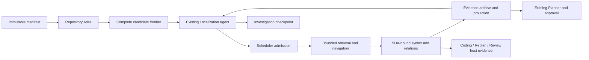

# PRG implementation and acceptance

Development baseline: `57f025b`, version 2.3.1. Safety branch:
`codex/pre-prg-v231-20261011`. Implementation branch: `codex/prg-v24`.
The original design remains in `PRG：Progressive Repository Graph 算法设计.md`.

## Batch A — structure and identity

`RepositoryAtlas` builds hierarchy from the existing allowed manifest without reading
source. Module boundaries require a visible package/build descriptor; directory names
alone do not prove a module's responsibility. Missing entries in a partial manifest
remain unknown. Source scanning is a separate budgeted operation.

Complete immutable manifests use content-addressed shards in `RepositoryIndexStore`.
Root publication follows shard publication. Mutable overlays and partial inventories
cannot publish shared roots. A manifest adapter reuses the acquired inventory and
preserves the original source IO accounting boundary.

Validation: 11 Atlas/router tests passed; `npm run build:core` and targeted formatting
passed. Coverage includes 2,000 files, nested modules, paging, excluded materials,
partial inventory, duplicate paths, configuration/file changes and overlay isolation.
Cold construction performs one manifest acquisition and zero source reads; warm
construction uses persisted shards and performs neither. Production wiring and Docker
acceptance follow in batch D; no capability or real experiment claim is made here.

## Batch B — syntax facts and static navigation

Pinned `@vscode/tree-sitter-wasm@0.3.1` supplies its own matching runtime and Python,
Java and C++ grammars. Parsing runs in an empty-environment worker, with a 512 KiB
input bound, an eight-second deadline and bounded syntax output. TS/JS retains the
TypeScript 5.9.3 resolver. No repository scripts, language servers or plugins execute.

Current source SHA and configuration identity bind facts. Immutable syntax shards
can be reused; manifest-dependent bindings are recomputed. Declarations and uniquely
resolved import files are static facts. Call/reference locations are exposed without
claiming overload, macro or runtime dispatch targets. Reverse coverage stays partial.

Validation: 47 parser, source-unit and graph regressions passed, including WASM on
Windows, TS aliases, overloads, macros, syntax failure, cache reuse and invalidation.
Core compilation passed. Shared Worker query wiring remains batch D work.

## Batch C — dynamic investigation and durable boundaries

The existing Localization Agent accepts `legacy`, `legacy-dynamic` and `prg` modes.
Dynamic modes remove the four-request/two-search/three-read stage allowances; Run
limits and per-operation admission still apply. Read range, snippet and full-file
bounds remain. Actual provider-prepared input is measured before generation without
reducing configured output. A larger bounded host evidence archive is projected as
complete records rather than injected wholesale.

Versioned investigation checkpoints retain source identity, source cache, evidence,
candidate/hypothesis state, completed queries/ranges, progress and original consumption.
Safe evidence boundaries resume without repeating completed work. Unconfirmed model
or IO reservations block rather than replay. Repeated requests stop immediately; two
rounds without new source stop without a summary call. The original lease policy is
retained for `legacy`; dynamic mode quotes remaining capacity beyond downstream needs.

Validation: 37 investigation, legacy-agent and lease tests passed. Tests include six
model requests with five fresh reads, duplicate/no-progress stops, resume with original
consumption, unknown dispatch refusal and pre-IO downstream rejection. Worker-wide
admission, mode freezing and production handoff are implemented in batch D.

## Batch D — production integration

`localizationMode` is an optional create-Run/API/benchmark runtime configuration field:

```json
{ "taskId": "<existing-task-id>", "localizationMode": "prg" }
```

Omission means `legacy`. `legacy-dynamic` retains the old retrieval path while sharing
dynamic admission with `prg`. Mode is written atomically into Run metadata; idempotency
and benchmark resume reject changes. No database migration is needed. Planner proposals,
Coding tools and approval contracts remain compatible.



Initial path/symbol/content retrieval still uses the existing index. PRG adds a complete
frontier, module/directory aggregation and incremental content search. Queries interleave
public tests and source candidates; acquired content answers later queries without
physical rereads. Region responsibilities remain `INFERRED`. Only observed descriptor
files establish module boundaries. Bounded model views do not discard the host frontier.

Navigation reserves consumer capacity, handles public tests in four languages and keeps
header/implementation pairing as an unverified hypothesis. Whole records, SHA and visible
ranges pass through existing Planner inputs. Shared graph queries add optional PRG facts
only in PRG mode; artifacts carry that mode into Coding and host evidence collection.

Pre-evidence checks include the next judgment and downstream capacity, using the same
configured token-price bound as actual request admission. Quotes do not consume resources.
Source IO, parsing and persisted index access enter the Run ledger separately from logical
tools. Known budget stops save evidence and reasons; unknown actions are not replayed.
Verified immutable source caches rebuild graph facts on recovery. An inspected marker
without recoverable current content cannot hide a candidate.

## Free acceptance and remaining limitations

| Check                                                                                    | Result                                                    |
| ---------------------------------------------------------------------------------------- | --------------------------------------------------------- |
| Full default suite                                                                       | 1,020 passed; 38 environment-gated/optional tests skipped |
| lint / typecheck / build                                                                 | Passed                                                    |
| Existing Workflow/approval/Coding Docker checks                                          | 8/8                                                       |
| Sandbox and large-file Docker checks                                                     | 5/5                                                       |
| Pinned Python/Java/C++ grammars in read-only, network-disabled Linux Docker              | 3/3                                                       |
| Dedicated PostgreSQL mode freezing, admission/settlement and approval recovery           | 3/3                                                       |
| Actual Worker request projection, generic fixture and optional E05/E06/E10 public replay | Four controlled scenarios; no paid models                 |

Public reproduction steps supply the replay queries; expected paths are not supplied to
navigation. A generic fixture verifies assertions, implementation and consumer in the
same actual Worker requests. The dataset replay exercises more than four Localization
decisions and reaches approval with scripted models. This proves orchestration and
evidence reachability, **not correct root-cause selection, repair or strict acceptance**.

An additional old P11 six-scenario integration was attempted and **failed**: its 45-second
fixture deadline cannot admit the configured 180-second Planner request. Both timeout
selection and fixture deadline exist at baseline `57f025b`; the baseline was inspected,
not rerun. No production limit was raised to make this fixture pass. Its configuration
compatibility remains a separate unresolved acceptance item.

Important limits:

- Atlas completeness refers only to the allowed manifest. Syntax, reverse consumers and
  behavioral coverage are independently partial; complete structure does not prove recall.
- Tree-sitter provides syntax, not compiler type resolution. Call/reference locations have
  unresolved targets. Python absolute import paths, Java classpath, C++ include configuration,
  overloads, macros and dynamic dispatch are not verified by filename uniqueness. Explicit
  relative imports/local includes have narrower static evidence. Header/implementation
  pairs remain hypotheses.
- E06 public replay reaches headers, tests and segment implementation; it does not establish
  that every compaction/reopen consumer is visible. E05/E10 also do not prove a complete
  causal chain. Missing behavior remains investigable under budget.
- Per-operation/source/request limits remain. Required whole records that do not fit cause
  an explicit stop. Dynamic allocation does not guarantee a number of model calls.
- Safe evidence checkpoints resume original consumption. A crash after dispatch but before
  a confirmed checkpoint can stop conservatively even if remote work finished; it never
  resets usage or automatically repeats that action.
- No LSP, repository-script graph builder, compiler plugin, vector database, whole-repository
  LLM summary or new write authority was added.

## Configuration before paid testing

Local stage settings were inspected without publishing credentials and left unchanged.
All stages inherit the existing Bailian-compatible provider:

| Stage              | Model                | Thinking        | Output / context tokens |
| ------------------ | -------------------- | --------------- | ----------------------- |
| Localization       | deepseek-v4.1-flash  | disabled / none | 4,096 / 32,000          |
| Planner            | deepseek-v4-pro-0813 | enabled / high  | 8,192 / 32,000          |
| Unified Coding     | glm-5.3              | enabled / low   | 8,192 / 32,000          |
| Independent Review | deepseek-v4-pro-0813 | enabled / high  | 16,384 / 64,000         |

Legacy Repair settings remain readable; all unified iterations use the Coding binding.
Experimental manifests must retain 75 logical tools, 25 steps, 250,000 tokens, 1,500,000 ms,
unchanged public validation and independent scoring. Use separate repository/cache
namespaces for cold comparison arms; report warm reuse separately. Do not clear caches
or switch modes in a running investigation.

## Release and paid-test gate

Keep version 2.3.1 throughout implementation. Complete free engineering acceptance,
freeze code/configuration, and notify the user before any paid PRG test. Real tests
require a subsequent instruction. Planned order: E05, E06, E10; dynamic legacy controls
follow only for strictly successful or materially advancing cases. No private scoring
answers enter retrieval or model context. The cumulative authorized ceiling is ¥175;
reload the ledger before experiments. One strictly passing PRG case plus engineering
acceptance is the agreed v2.4.0 gate, not proof of general success rate or attribution.

This implementation issued **zero paid requests**. Retained campaign accounting is
**¥154.664838 / ¥175**, leaving **¥20.335162**, including existing unknown fee bounds.
The next case needs at least ¥4 available plus per-request admission. PRG E05 → E06 → E10
real runs remain **not run** pending the user's subsequent instruction. Successful or
materially advancing cases receive `legacy-dynamic` controls; one success does not establish
overall stability or isolate the contribution of PRG from dynamic allocation.
