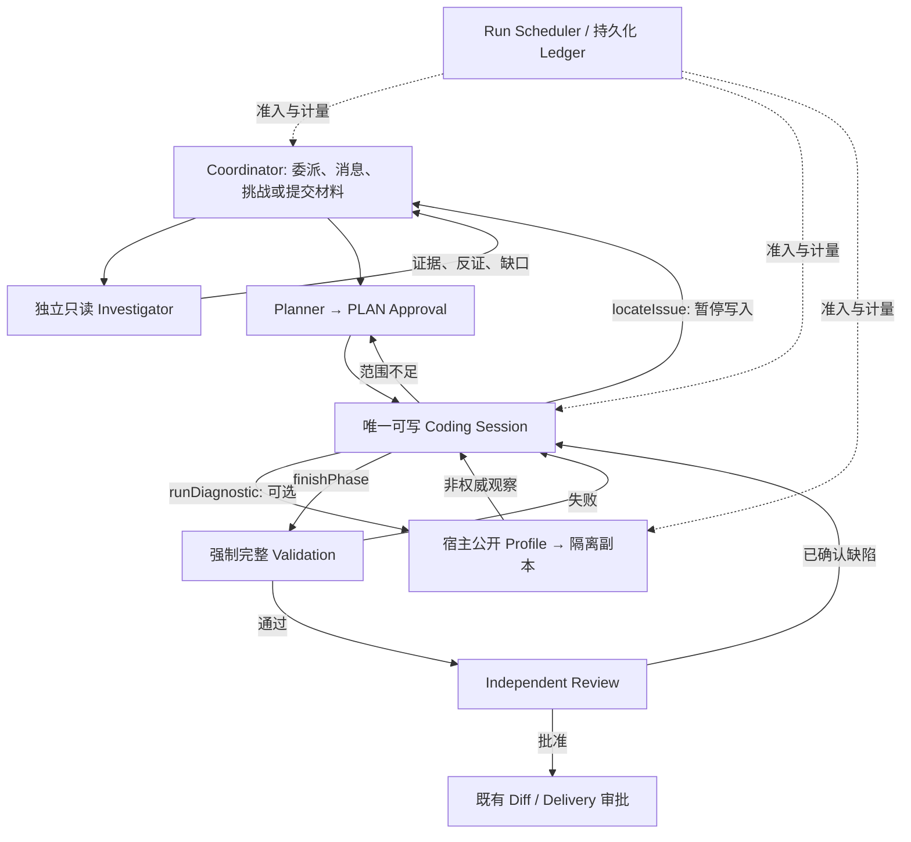

# 稳定性修复与受控自主动作

适用于 `codex/stability-autonomy`，版本保持 2.4.0。基线、原始需求和实施顺序见 [计划](stability-autonomy-plan-20261013.md)。本设计扩展现有生产执行器，不新增 Workflow 或 Agent 生命周期。

## 决策与执行边界

Coordinator 继续使用 `DELEGATE/SEND/CANCEL/PROPOSE_PLAN/STOP`；Investigator 使用既有读取、搜索、关系查询与结果动作。Coding 可以直接编辑、请求调查、选择公开诊断、请求重新规划或提交候选，没有要求每次按同一顺序调用。工具描述只是提示，Executor、批准范围、源码 SHA、租约与 Scheduler 才是执行边界。

只读团队不获得任意命令执行权。Review 沿用独立裁决及已有受限补证，不通过团队领取额外反馈轮次。模型共识、诊断通过和单项 Issue acceptance 均不能覆盖最终 Test、Review 或完整性失败。

## 资源治理修正

`codingContinuationOperationPlan` 将后续路径保留为可审计的操作树：共享 Validation/Review 加真正互斥的完成或 Replan 路径。每个模型节点保留本阶段输入、输出、请求数和价格身份；不再用最高输出单价乘全部 token。顺序节点仍累加，恢复输出与真实下游成本不删除。

`resourceContinuation` 新增可选 `costStatus/modelCalls/audit`。显式 `UNPRICED` 不得因数值归一化变成零价。未知回执继续占用，预约不计成消费；后续结算仍使用原账本 CAS。

团队调查共享一次 Coordinator 收尾预约，使用当时可构造的 `teamDecisionView` 和投影报价。Investigator 必须让出这部分容量；Coordinator 使用时转移预约，不重复扣除。证据增长后重新报价，不能保证任何未来大小都能放入预留。真实不足仍阻断。

Planner 的已有恢复和正常判断共享一个绝对阶段期限，删除把同一期限重复累加的 180 秒。缩短请求期限由实际模型准入原子执行；早期预检不把经过数据库操作后必然过期的“刚才剩余毫秒数”当成固定期限。

## 有界消息纠正

`replyTo` 只接收已有 message ID，`taskId` 独立。非法引用返回字段、期望类型、错误原因及合法结构；宿主不猜测或改写模型参数。

每个 Agent Session 最多使用一次参数纠正信用。纠正状态、关联操作、请求计数和消费持久化；新 Worker、恢复或再次审批不能领取新信用。纠正仍经原 Scheduler，预算不足不发请求。已完成的同批动作不重放；未知发送者、跨 Run 引用、因果不合法和越权不是可绕过的格式问题。

消息只有经过发送者、接收者、task、replyTo 和证据校验后才提交。接收者请求视图携带相关消息和反证，保留后续动作关联。免费受控模型证明的是可执行因果链；真实模型是否会选择并正确使用该链路须另行实验。

## 所有权与可恢复操作

Sandbox 操作分别记录 ownership-before、Docker transport、ownership-after 的有界 span。transport 超时意味着结果未知，旧容器不能被迟到成功回执重新开放。RunProcessor heartbeat 以最后确认的 lease 设置 watchdog；pending 续租不能无限延长执行权。

数据库先锁定 Run 所有者行，再读取数据库当前时间。等待行锁期间已经过期的 owner 不能续租、完成 Run 或创建审批。重派发仍核对 `executionOwner/dispatchRevision`、候选 checkpoint 与源码身份。

失败候选的后续独立评估若再次失败，保留原始 Coding 错误，并记录 `benchmarkEvaluation=INCOMPLETE`；成功候选的评估失败仍必须拒绝，不能降格为成功。

## 编辑失败的当前证据

`applyPatch` 的 `CONTEXT_MISMATCH` 若确认源码完整无变化，可从宿主已经取得的写前源码中返回 hunk 周围完整行、完整 SHA 和来源。总片段最多 8 KiB、每段最多 200 行，不追加物理读取、不模糊匹配、不自动修补。

只有当前身份与完整无变化观察都成立，才使用原有的一次编辑纠正信用。源码过期、未知副作用、片段不足或越权继续拒绝或要求合法刷新。纠正本身不算实质进展，不重新开放全仓探索，未完成任务和公开失败继续保留在同一 Coding Session。

## 可选 `runDiagnostic`

开关为创建 Run 时冻结的 `teamConfiguration.diagnosticsEnabled`，缺省关闭，旧 Run 不受影响。只有同时存在宿主提供的公开验证 profile 时才提供工具。模型只能提交 `{checkId, reason}`，不能指定 program、参数、环境、网络或私有评分命令。benchmark 工具白名单仍需明确允许 `runDiagnostic`；伪造工具调用在 Executor 拒绝。

诊断读取当前候选身份，在无挂载、所有权有效的候选容器上捕获临时镜像，然后在新容器运行冻结的公开检查。只读根文件系统、无网络、无 capabilities、非 root、清空继承环境；代码复制到独立 scratch，候选不挂载。只使用已存在依赖，不安装依赖。Docker commit 默认暂停容器；不发送 Docker 29 已弃用的 `--pause` 参数（[官方说明](https://github.com/docker/cli/blob/master/docs/deprecated.md)）。

一次诊断及快照准备共享最多 30 秒，另外为清理预留有界期限；CPU、内存、PID 上限不超过候选限制。每 Run 最多两次尝试。同一源码、profile 和检查的完整回执可以复用，缓存命中不算新证据；未知操作不自动重试。

身份准备之前先保护下一次 Coding 判断与必要下游；五个 Docker 操作共用一次 lifetime 准入，输出上界 166 KiB，按实际返回字节结算。清理不依赖耗尽资源后再次申请额度。内部执行次数和字节以 Run Ledger 为权威，旧 Session 工具计数只表示外层 Agent 调用；容器内 copy/commit 的磁盘 IO 标为 `UNOBSERVED`。报价可以在独立副本中添加明确未执行的工具观察占位，不写回 Session，也不传给 Provider。

`agent-diagnostic-v1.json` 使用原租约 Artifact 存储：`PREPARED → INFLIGHT → COMPLETED`，未派发为 `NOT_ISSUED`，不确定回执为 `UNKNOWN`。稳定 ID 关联源码身份、profile SHA 和 check ID。结果带 `OBSERVATION_ONLY`、`finalValidationRequired=true`；命令退出、超时、依赖缺失和环境失败分别记录。

模型可以根据该观察继续改、请求补证或提交。最终完整验证和独立 Review 始终由 Workflow 强制执行。可选诊断可能额外耗时并复制较大工作区，因此默认关闭；不能把它描述成免费 IO 或成功率提升。

## 兼容、回退与实验

新增字段均为可选，无数据库结构迁移。关闭新 Run 的诊断开关可恢复原策略；在途 Run 继续使用冻结配置。消息纠正和预算、所有权安全修复不保留故意错误的兼容路径。需要代码回退时先排空在途团队 Run，再切回保护分支，不能让旧进程接管未知操作。

本轮没有新增付费请求。真实 E01–E09、消息因果链和三模式同预算对照均标记 `NOT_RUN`，历史 2/9 不与免费回放合并。只有后续独立授权、冻结配置并完成真实门禁后，才能评价修复率或考虑 v3.0。
