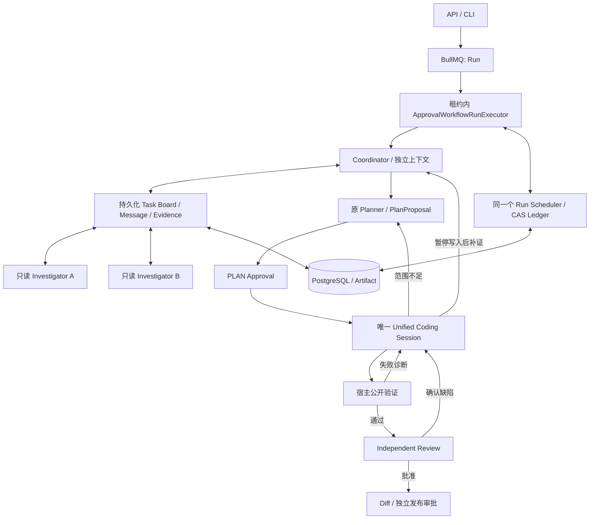

# v3.0 持久化动态协作 RFC 与实施记录

状态：实验实现及免费验收已提交，真实稳定性验收未达标，版本保持 2.4.0。基线 `93342f5`，保护分支 `codex/pre-v3-93342f5`，开发分支 `codex/v3-multi-agent`。原始需求见仓库根目录 `DevFlow_v3.0_MultiAgent_Refactor_Brief.md`，原文保留。初始 R1/R2 见[验收报告](v3-validation.md)，后续四次 E10 及未知回执停机见[有界迭代记录](v3-e10-iterations-20261013.md)。

## 基线源码审计（2026-10-13，以下描述重构前状态）

生产入口为 API → BullMQ → RunProcessor → ApprovalWorkflowRunExecutor。`packages/workflow` 的 DefaultWorkflowEngine 仍是 NOT_IMPLEMENTED 占位，不能作为新团队执行入口。现有源码包含 PRG、PlanProposal/Approval、统一 CodingSession、宿主公开验证、独立 Review、受控 Replan 和 GitHub 发布审批。

Scheduler 使用 Run.metadata 中的持久化 CAS 账本；预约和消费独立，未知外部消费保留上界。但当前事件写入与预算 CAS 没有统一租约防护，Provider 操作 ID 使用随机值，不足以支持多 Agent 的确定性恢复。下游容量主要是报价而非共享预约，不能直接用于并发子任务。

ContextEvidenceStore 是请求级完整记录/投影存储，不是跨 Agent 共享数据库。CurrentSourceCache 绑定单个 Sandbox，不能直接跨恢复复用。Coding Session 已合并修改和修复，但现有恢复要求核实 Replan 候选检查点。新团队必须另存身份、收件箱、操作和消费关联，不能把旧检查点当作全新额度。

数据库已有 Run、Step、ToolCall、Artifact、Event、Approval，没有 AgentInstance、任务板、消息及共享证据实体。CLI 的独立 Agent 路径不具备同等生产审批和验证，不能直接用作公平基线。

基线定向测试：7 文件、78 PASS、3 SKIPPED。受限 Windows 沙箱首次运行存在 Vitest 临时缓存 ENOENT，正常本地环境重跑通过；不将环境失败计为源码缺陷。完整工程/Docker 尚待阶段验收。

## 架构选择

比较了 Manager-as-tools 与持久化消息驱动团队。前者简单但无法单独满足挑战、取消、恢复与审计；后者可靠但不需要现在引入独立 Agent 队列。采用持久化任务板 + 原 Run Worker 内有界并发：一个租约拥有者、最多两个并行只读调查、唯一 Coding 写者、独立 Review。复用 BullMQ、Prisma、Runtime、Tool Policy、Sandbox 和 Scheduler，不引入额外 Agent 框架。

Coordinator 选择 delegate/request_evidence/challenge/cancel/propose_plan/stop；Investigator 有独立目标、Session、收件箱及只读工具。消息与解释均为不可信材料。观察有效不等于根因成立，团队共识不等于测试、Review 或审批通过。

新增冻结 executionMode：workflow（默认）、team、single（生产安全边界内的单解题 Session 对照）。localizationMode 独立冻结。默认最多 2 并行调查者、4 调查者实例、12 调查任务、64 条消息；所有模型调用和 IO 计入原 Run。重复整轮立即停止，连续两轮无有效新证据停止，不追加总结请求。

持久实体：RunTeamState、AgentInstance、AgentTask、AgentMessage、SharedEvidence、AgentOperation。消息具备宿主身份、去重键和回复因果；证据具备仓库/源码视图、完整 SHA、行范围、观察/解释/假设类别与来源。完整历史以 Artifact 保存，模型只收到相关投影。

租约与版本检查在事务中执行。操作预约先持久化，外部调用在事务外，回执与预算结算关联；未知调用不重发、不归零。任务依赖禁止循环，取消传播，陈旧 Worker 不能提交权威结果。Coding 补证时暂停写入，调查结束后恢复；新增路径仍须现有 Replan 核实及新 PLAN Approval。

并发资源相加，确认并行的时间才按关键路径估算；必要下游在 Run 级共享预留一次。预约不是消费。原方案为 75 逻辑工具、25 步、250000 Token、25 分钟；后续用户授权的新 Run 配置调整为下文的 32 步 / 320000 Token，其他限制不变。证据恢复与缓存命中如实记录，禁止把未知价格归零。

## 阶段与门槛

| 阶段 | 内容                                            | 门槛                                                        |
| ---- | ----------------------------------------------- | ----------------------------------------------------------- |
| 0    | 审计、版本保护、冻结协议                        | 保留原始材料，基线测试和公开文件检查                        |
| 1    | 内存任务板与独立 Agent 闭环                     | 不同证据改变委派；A 的反证改变 B 的实际动作；简单任务零委派 |
| 2    | Prisma、租约、消息和并发预算                    | 数据库竞争、取消、未知回执、崩溃恢复，不重复计费            |
| 3    | Worker/Planner/Coding/Review 接入及 single 对照 | Docker 完整链路、审批恢复、保护与版本校验                   |
| 4    | 工程检查和冻结真实对照                          | 同条件实验、严格评分、明确负结果                            |

各阶段独立提交，免费验收后才进入下一批。数据库迁移只增加结构；旧 Run 继续 workflow。关闭新团队创建后排空/取消在途团队，再回退二进制，不让旧 Worker 接管未完成团队 Run。

## 实验协议与升版

### 2026-10-13 用户调整（优先于下述原始对照协议）

本轮以稳定性为先，先完成持久化、并发、权限、恢复及生产链路免费验收，再只执行 E10。E05/E06 和三组真实对照暂停，升级后的多题实验由用户后续安排。保留原对照实现及免费验证，未运行项记 NOT_RUN。

E10 中可复现的工程缺陷允许定向修复：冻结失败证据 → 免费回放 → 最小修复 → 相关及保护回归 → 新冻结批次复测；不能在同一冻结批次改代码或合并不同版本成绩。单纯模型判断或缺证且没有确定工程缺陷时停止，不以通关为必达结束条件。若定向修复引入新的生产阻断，先撤回该修复至前一验收点并记录；重复出现此类新阻断即结束本轮，等待用户安排。不开展无依据扩大重构。

累计费用上限已批准为 ¥200，最近占用 ¥156.939491，余 ¥43.060509。用户同时允许适度增加单 Run 的 token 和步骤：新任务采用 320,000 token / 32 步，仍保持 75 次逻辑工具、25 分钟及既有修复/重规划限制；已有任务恢复保持原冻结上限，不能续领资源。E10 不通过时仍保持 2.4.0，不以流程恢复冒充升版门槛达成。

### 原始三组对照协议（保留，真实执行暂停）

计划 E05 A/B/C、E06 B/C/A、E10 C/A/B，每组合一次；A=single、B=workflow、C=team。三组同一 PRG 检索、输入、公开验证、评分器、冷缓存和硬预算。解题角色统一 glm-5.3/thinking/low/8192/32000；Review 继承 DeepSeek high/16384/64000。每 Run 成本上限 ¥4。

当前保守占用 ¥156.939491 / ¥175，剩 ¥18.060509。启动前重核账，逐题最低 ¥4 预留及逐请求预检。余额不足标 NOT_RUN，不自动涨额度。冻结后不修改源码、不自动重试；普通失败继续，权限/完整性/预算异常停止。

严格 PASS 同时要求完整工作流、公开验证、独立 Issue/原测试/完整性及 Review。只有工程和保护验收通过、真实协作轨迹证明补证改变动作、且至少一题 team 严格 PASS 才升 3.0.0，否则保留 2.4.0。架构交付与能力提升分别报告；无标注的定位召回不编造。私有答案不进入模型或源码，原始请求/账本/候选仍 Git 忽略。

## 验收日志

- Phase 0：基线审计完成；后续验收待执行。
- Phase 1：新增动态任务板核心及独立 Agent Session；受控测试证明零/单/多调查委派、反证改变另一 Agent 的实际读取、重复探索停止、未知调用恢复阻断及引用校验。3 个相关测试文件 34 PASS；build:core 和新增代码 ESLint PASS。此阶段尚未接入真实 Provider，不代表真实修复能力。
- Phase 2：新增六张持久化团队表与 Run 租约事务；回执和 Scheduler 结算可原子提交，JSONB 键顺序不影响身份。模型/工具/控制动作完成后崩溃可本地续处理，未知调用不重发。团队与预算定向测试 49 PASS；PostgreSQL/Docker 8 PASS；build:core 与公开文件检查 PASS。生产接入仍待 Phase 3。
- Phase 3：真实 Worker 接入团队调查、原 Planner 和 PLAN 审批。Coding 的 `locateIssue` 可在原重定位额度内暂停写者、启动只读团队、返回当前证据；不重新授予修改范围。生产 PostgreSQL/Docker 12 PASS，包含团队与 single 两种模式的审批→错误候选→公开 Test 失败→同一 Coding Session 修复→重测→独立 Review。single 延续原 Solver 身份、决策引用和执行模型，所有阶段计入原 Run。租约约束传递到事件、预算和候选 Artifact；陈旧 Worker 写回被拒绝。受控结果证明编排与权限，不证明真实模型修复能力。
- Phase 4：完整免费验收后冻结两次 E10。R1 发现并发账本竞争和并行时间预留问题，经免费重现后修复；R2 已派发两个独立调查者，但在 Planner 前因下游费用报价停止。最新全仓 1036 PASS / 48 SKIPPED，PostgreSQL/Docker 13 PASS；其余工程、旧生产路径结果及每批身份见验收报告。未达到真实协作影响和严格修复门槛，停止继续迭代，保留实验开关和 2.4.0。

## 启用、审计与当前边界

| 接口边界           | 实现                                                               | 权威与恢复要求                                                          |
| ------------------ | ------------------------------------------------------------------ | ----------------------------------------------------------------------- |
| 团队决策与任务推进 | `apps/worker/src/team/engine.ts`                                   | 稳定 Agent/操作 ID；模型只提出动作；宿主验证角色、引用、依赖及次数      |
| 独立请求视图       | `team/context.ts`                                                  | 只投影本 Agent 的任务、收件箱、反证及有效证据；记录实际可见与省略项     |
| 原能力接入         | `team/workflow-bridge.ts`                                          | 复用检索、PRG、源码读取和阶段模型；下游共享预约；返回原 EvidencePack    |
| 原子消费           | `team/budget-store.ts`                                             | 同一事务关联团队回执与原 Run 预算 CAS；不能通过 Agent 新增额度          |
| 持久化与租约       | `packages/database/src/prisma-team-store.ts`、`execution-lease.ts` | 锁 Run 校验 owner/revision/期限/取消；失去租约后禁止写回                |
| 生产交接           | `approval-workflow-run-executor.ts`                                | 沿用原 Plan、审批、Coding 检查点、验证和 Review；团队不授予写权限       |
| 对照身份           | `team/solver-session.ts`                                           | single 的规划与 Coding 延续同一 Solver 身份和决策引用；独立 Review 保留 |

操作先持久化，再向外部派发；确认回执与资源结算共同提交。已完成回执在崩溃后本地续处理；已派发但回执未知时保留预约并阻断，不自动再调用。审批等待保留原预算和期限。SharedEvidence 中的完整 SHA、范围和来源仅证明观察身份，不证明修复正确。

- 部署先执行增量 Prisma 迁移；API 和 Worker 设置 `DEVFLOW_TEAM_ENABLED=true`，创建 Run 时指定 `executionMode: "team"`（或受控对照 `single`）。缺少持久化、有效租约或预算账本时明确拒绝。默认 `workflow` 不受影响。
- Coordinator/Investigator 的 `LLM_COORDINATOR_*` / `LLM_INVESTIGATOR_*` 分别继承 Planner/Localization。single 使用 Execute 模型贯穿求解。非敏感绑定哈希在首次团队初始化冻结，审批恢复时核对；不保存密钥。
- `/api/v1/runs/:id/team` 返回任务板、消息及证据身份，现有 SSE 的 `WORKFLOW_CHECKPOINT` 带团队版本和状态。完整团队历史、每次实际请求投影保存在 HOST_ONLY Artifact；源码、模型判断和工具错误分别记录。过期任务结果标记非当前，不能作为当前源码事实。
- Investigator 使用结构化决策表达只读动作，由宿主复用现有检索/图/源码接口执行，无 shell、写入、审批或测试裁决权。模型输出无效或截断时目前明确停止；不猜测修正动作。未知已派发结果阻断恢复，已确认回执可本地续处理。
- 子 Agent 仍在同一 Run Worker 进程内，不能独立跨进程派发。生产调查的实际并发派发组已接入时间报价：同组未完成操作取最长预留；不同组、后续顺序操作及独立下游预约相加。Token、费用、模型次数和 IO 始终相加。组身份由宿主创建并持久化，模型不能声明自己的操作属于并行组。
- 同 Run 的 Scheduler 及原子回执适配共享短事务写入队列，避免搜索 IO 扇出饿死另一调查者的 CAS。模型与 IO 本身继续并行，跨 Worker 的数据库 CAS、租约检查及未知消费阻断保留。
- 后续已改为逐角色输入／输出报价；请求期限在真实可用窗口内分配并持久化。Runtime 复用有容量上限的不可变索引读取，缓存不跨 Worker，缺失和错误不缓存。预算拒绝保留完整报价，工具与模型超时单独归因；未知 Provider 消费仍保留上界。
- 新结果、阻断或发给 Coordinator 的消息触发控制交接，等待已派发操作结算后重新协调；规划交接会关闭旧调查并保留未完成缺口。请求展示扣除共享下游预约后的剩余额度，不授予新权限。最新真实测试仍被未知模型回执阻断，尚未验证该交接成功；累计保守占用 ¥160.123911 / ¥200，费用审计未通过后已停止新增付费请求。
- 关闭开关禁止创建新团队；排空或取消在途团队后再回退二进制。旧二进制不能接管未完成团队 Run。保留新增表及历史，禁止以删账本或新建 Agent 重新领取预算。
